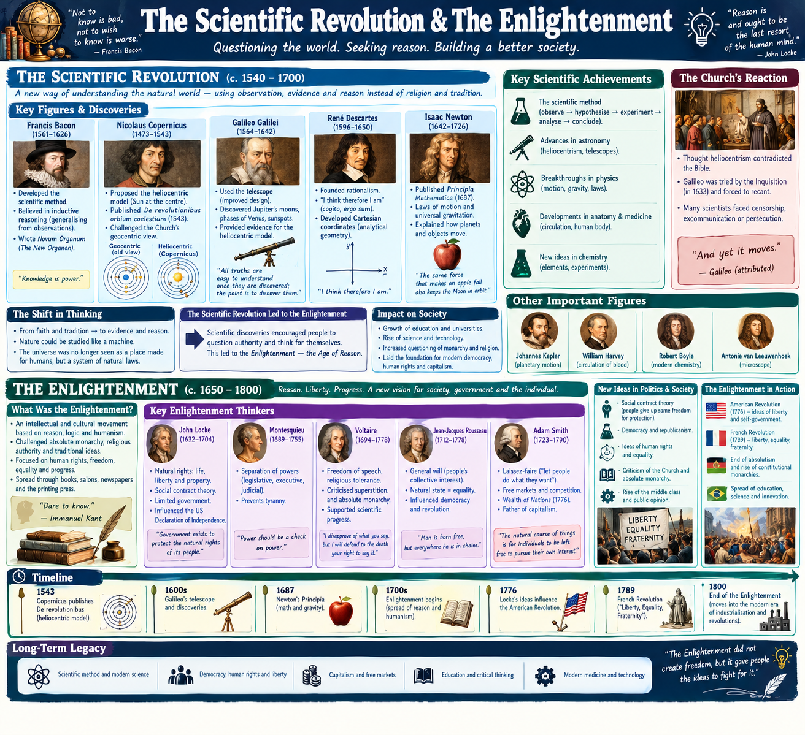

francis bacon developed the scientific method. copernicus proposed the heloiocentric model where the sun was the center. gelileo confirmed that sun is the center which made church upset. decartes "i think therefore i am" analytical geometry.newton published pricnipa mathmatica. scientific revolution led to the enlightenment -> age of reason. bought about new theories on how government should be run

### enlightenment (1685–1815)
The Age of Enlightenment (1685–1815) was a revolutionary intellectual movement that transformed human society by arguing that reason, logic, and empirical evidence—rather than religious dogma or the divine right of kings—should be the foundation of governance and human rights. Guided by key philosophers like John Locke, Voltaire, and Jean-Jacques Rousseau, the era introduced radical concepts such as natural rights (life, liberty, and property) and the social contract, which asserted that a government’s legitimacy comes strictly from the consent of the governed. By challenging absolute monarchies and institutional corruption, this philosophical shift served as the direct catalyst for the Atlantic Revolutions—including the American, French, and Haitian revolutions—ultimately dismantling the old feudal world order and laying the structural and legal foundations for modern constitutional democracies 

John Locke believed all people had natural rights to life, liberty and property. Adam Smith supported Laissez-faire ("let people do what they want")free market father of capitalism. Households labor to factories and use their wages to buy those factories' goods—became the dominant economic reality during the Industrial Revolution (1760–1840). This was the era where agrarian self-sufficiency died out, forcing families to rely entirely on markets for survival
