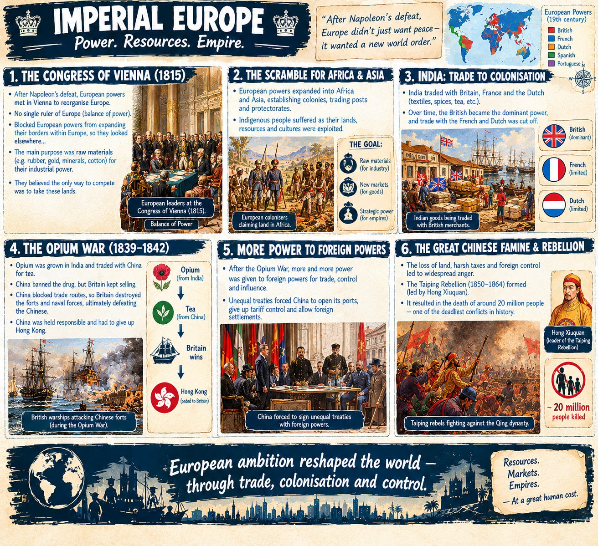
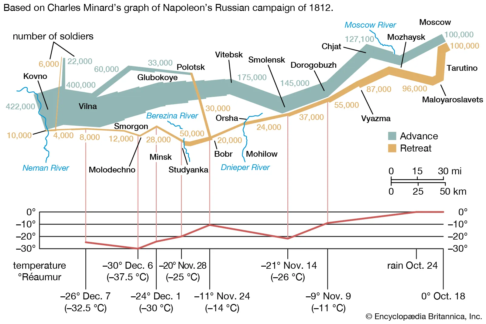
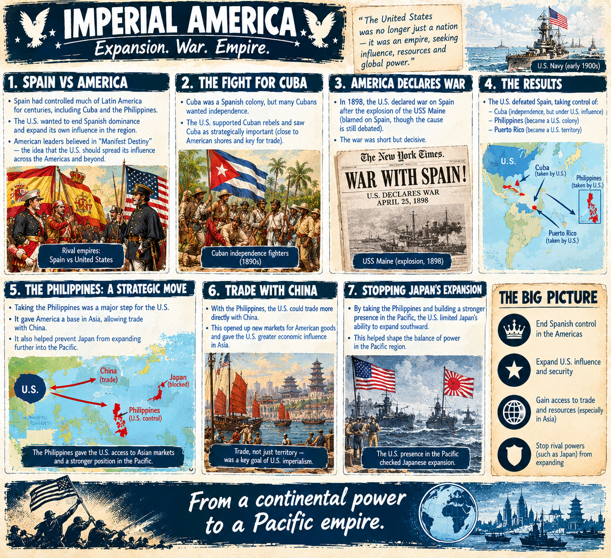
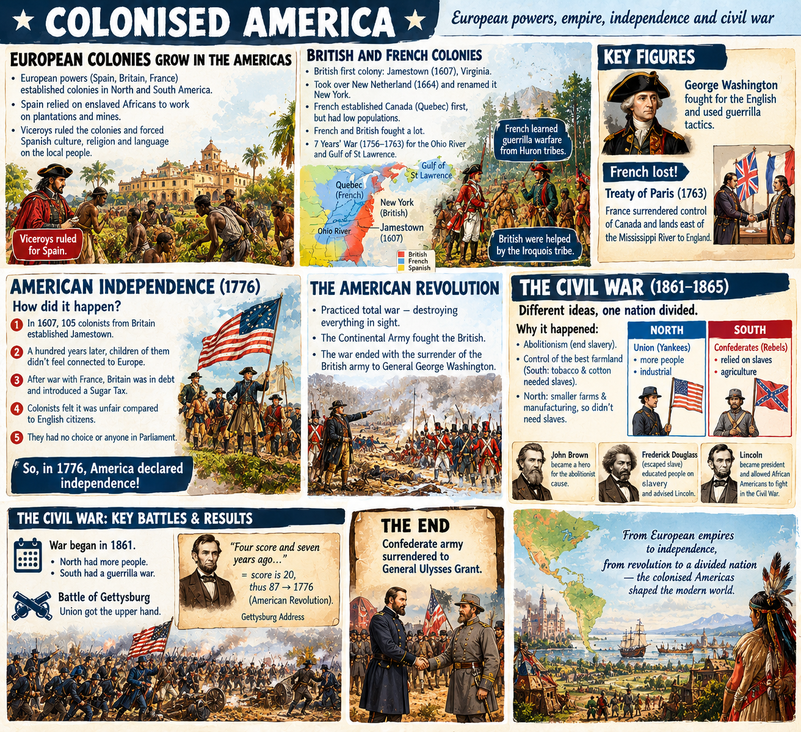
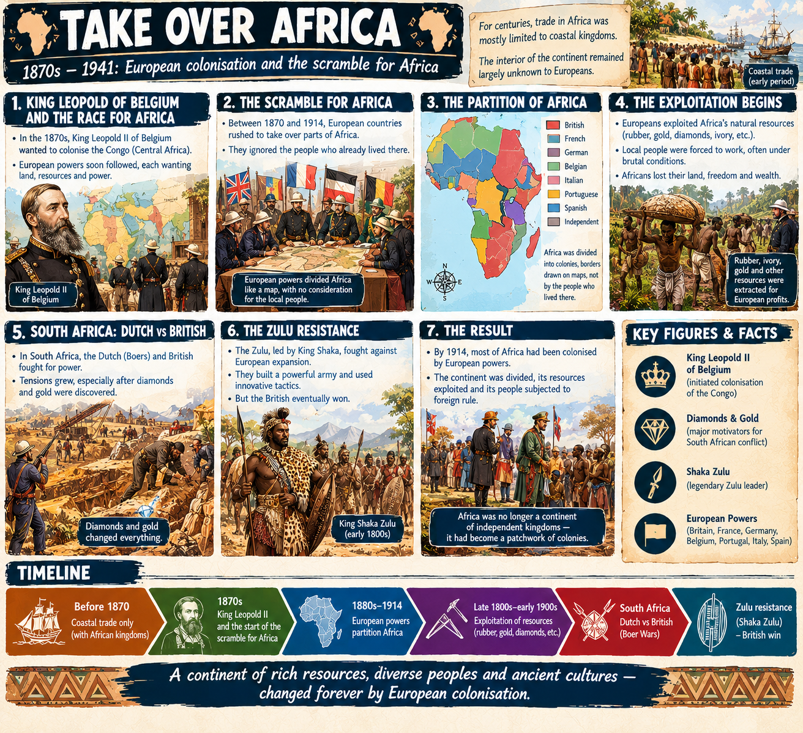
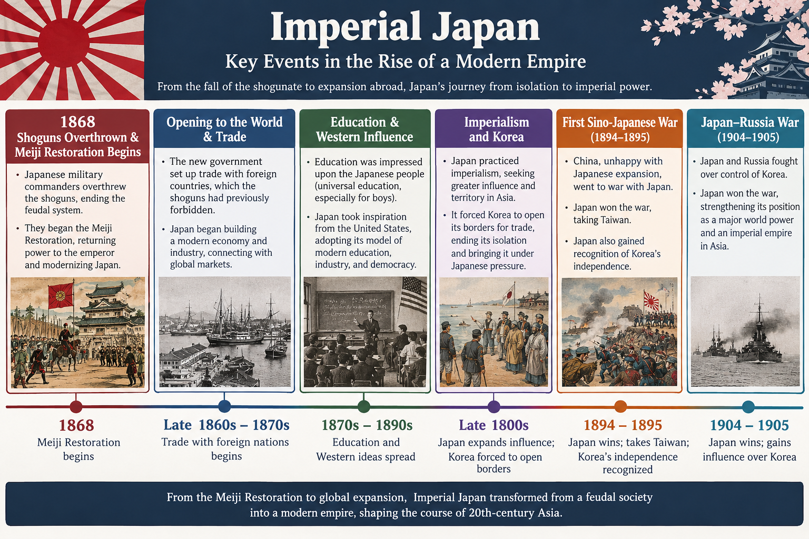

Imperialism (1800-1914). Imperialism is the act of expanding rule to other countries.
- [imperial europe (1870–1914)](#imperial-europe)
- [imperial america (1898–1914)](#imperial-america)
- [imperial japan (1868–1945)](#imperial-japan)
- [east india company (1757–1858)](#east-india-company)

#### imperial europe 
The Napoleonic Wars (1803–1815) - French (Napoleon Bonaparte) vs Europe. Napolean is known for sheer speed and relentless aggression. 

1815 Congress of Vienna reorganise Europe after the defeat of Napoleon. No single ruler of Europe. Blocked European powers from expanding their borders within Europe, so they looked elsewhere...

main purpose was raw materials for power. They thought the only way to compete would be to take these lands. lots of indigenous people suffered.
Victorian era: 1837 - 1901. first national railways, the Reform Act.
india traded with britain, french and dutch but this was cut to being just britain
opium war (1839 to 1842): opium grown in india was traded with china for tea. China banned the drugs but britain kept selling. Chinese blocked routes but Britain destroyed the forts ultimately defeating the chinese. China was held responsible and had to give up Hong Kong. More and more power was given to foreign powers for trade. A rebellion formed that led to the killing of 20 million people.

#### imperial america

colonised america (1607–1783)

european colonies grew in americas
spanish relied on enslaved africas to work for them and viceroys ruled and forced spanish culture
british first town was in jamestown, 1607 virginia. took over new netherland in 1164 and renamed it new york. 
french candana established in quebec first but low populations
french and british fought a lot 7 year war for ohio river and gulf of st lawrence.
french learned gurerilla warfare from huron tribes. british were helped by Iroquis tribe.
George washington fought for the english and used gurerilla tactics. French lost!
Treaty of Paris french surrencded control of Canada and lands east of Mississipi river to england
1776 america declared independence how did it happen?
In 1607, 105 colonists from Britain established in Jamestown. Hundred years later children of them didn't feel connected to europe. 
After war with France, Britain was in debt and thus led to Sugar tax. 
Colonists felt it was unfair compared to english citizens. They had no choice or anyone in parliment.
1861-1865: Civil war
nationalism was sweeping US states different ideas about abolitiionism and control of best farmland
south tobacco and cotton so needed slaves
north had smaller farms and manufacturing so didnt need slaves
Union (north) yankees vs Confederates (south) -rebels
abolitionist cause john brown became a hero 
federick douglass (escaped slave) educated people on slavery and advised lincoln the elected presenident of america and convinced lincoln to let African American 's fight in civil war
war began in 1861 
north had more people but south had gurilla warfar
battle of gettysburg union got upperhand + lincoln did his gettysburg address Four score and seven years ago = score is 20 thus 87-> 1776 american revolution. They practiced total war destroying everything in sight.
confederate army surrendered to general ulysses grant

**south america**
south america bolivar led revolution all over south america. Spain was weak after war with Napolean. 

Spain vs Ameria. US also wanted to expand and fought for Cuba's independence. US declared war on Spain -> taking philiphines and cuba. taking the philiphines was a strong move -> allowed trade with china and stopping japan expanding 

#### take over africa

1870s-1941: before then trade was only really done with coastal kingdoms and never ventured into the continent. king of belgium wanted to colonize central africa. europe soon followed and scrambled to take over parts of africa. The europeans just paritioned africa as they liked on the map with no consideration for the locals. Then the exploiting began. south africa dutch and british fought for power especially once it was discovered there were diamons and gold. africa zulu fought against europeans under leaeder shaka zulu but then british eventually won.

#### imperial japan 

1868, shoguns were overthrown by japanese military commanders who began the meiji restoration. The group went on to set up trade externally which shoguns previously forbade. Education was impressed upon Japanese and inspiration was taken from US. Japan also practiced imperialism and forced korea to open borders for trade. China unhapy with Japanese expansion led to first sino-japense war with japan winning and taking Taiwan and recognise Korea's independence. Japan and Russia also fought over korea japan won.

#### east india company
india sepoy rebellion. mughal empire waned and east india company hired indians called sepoys. the rifles needed cow and pig fat to grease the rifle. this led to a mutiny but ultimately failed. british govt took over east india company. british built things like transport + education but prevented indians from gaining any real power.

#### china
china boxers rebellion hated the foreigns in China. This led to foreign powers coming in and restoring order.
