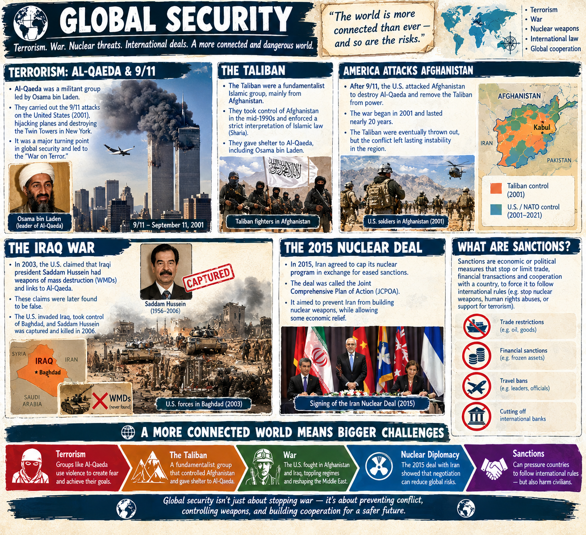

Terrorism by Al-qaeda 9/11. Taliban were the fundamentalist part in charge of afghanistan. America attacked afghanistan and taliban thrown out
America claimed Iraqi president(Saddam Hussein) had weapons of mass distruction + links to Al-qaeda.
US took over Bagdad, Iraq and Saddam killed.
In 2015, a historic deal was done to cap nuclear pogram in exchange for eased sanctions. Sanctions normally stop trade to force nations to follow international rules.
