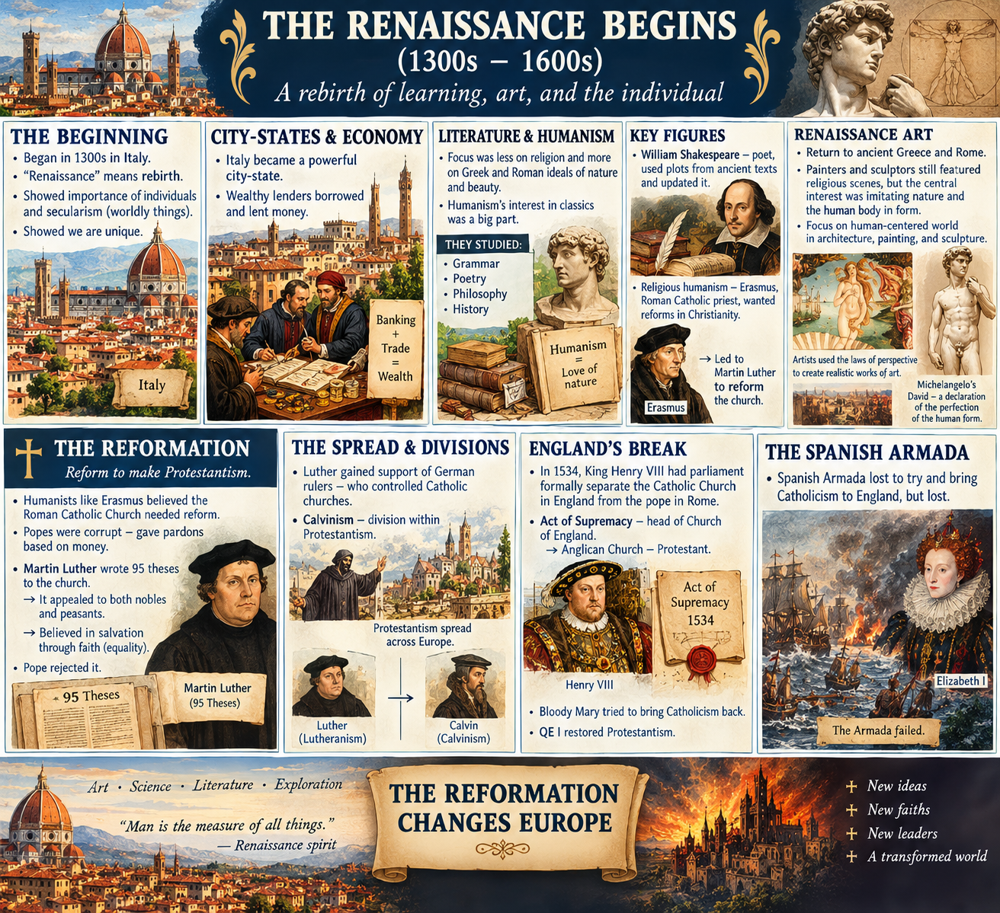
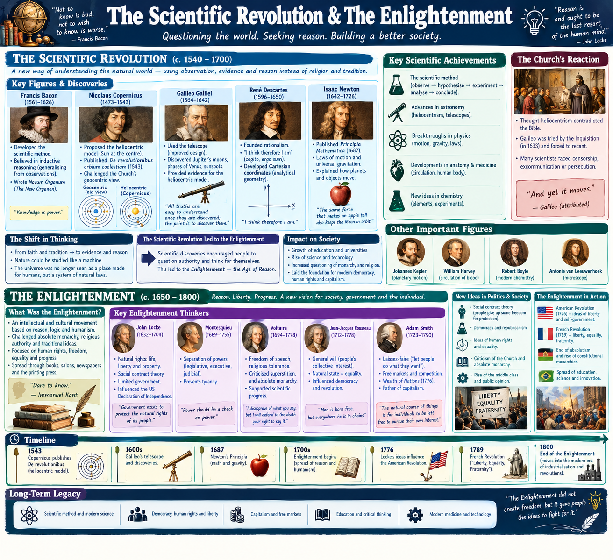
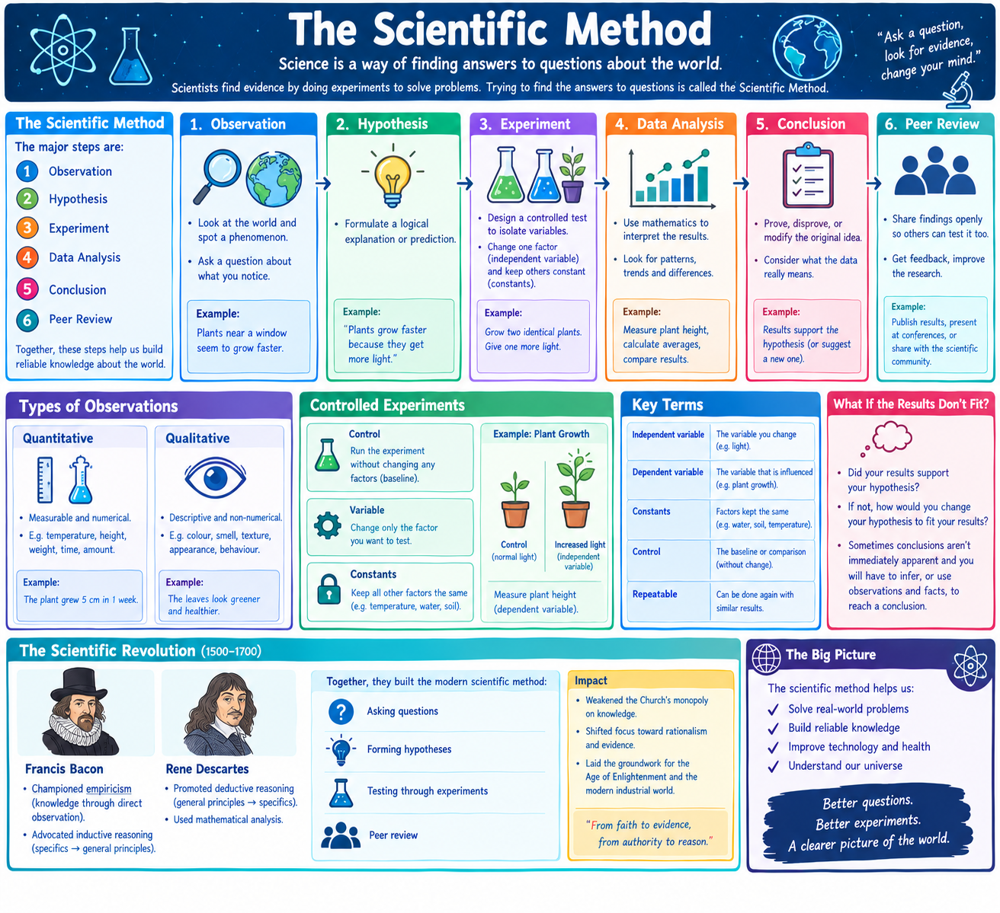
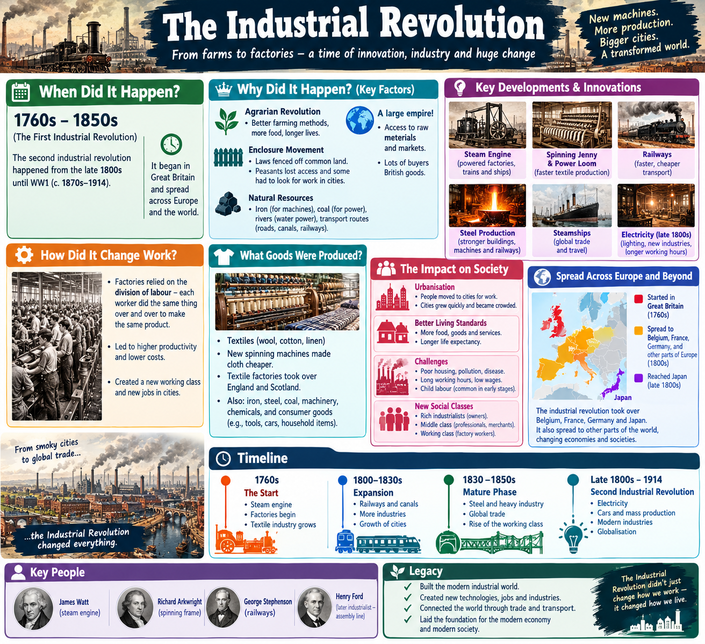
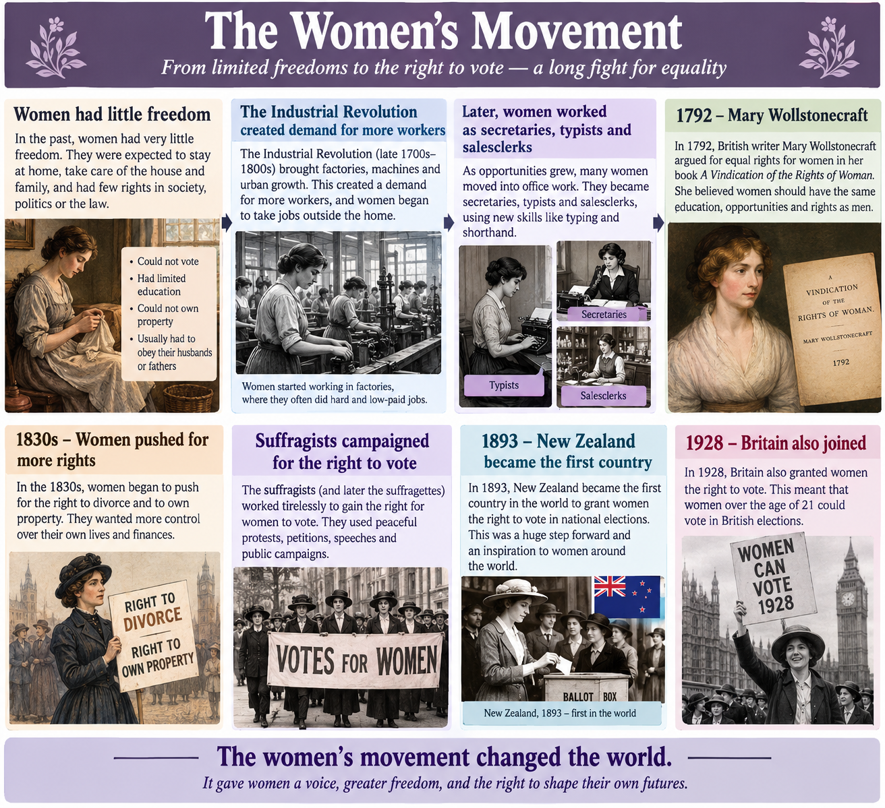

#### renaissance

Began in 1300s in Italy renaissance means rebirth. Renaissance showed importance of individuals and secularism (worldly things) showed we are unique.Italy became a powerful city-state wealthy lenders borrowed and lended money. renaissance literature, focus was less on religion and more on greek and roman ideals of nature and beauty. Humanism's interest in classics was a big part. They studied: grammar, poetry, philosophy, history. Humanist love of nature. William Shakespeare poet, used plots from ancient texts and updated it. Thomas Hobbes: best known for developing social contract theory and arguing that an absolute sovereign is necessary to prevent human society from descending into chaos and civil war. John locke refuted this  "Father of Liberalism" and one of the leading figures of the Enlightenment. Thomas Jefferson drew directly from Locke when drafting the US Declaration of Independence, famously adapting Locke's "life, liberty, and property" into "Life, Liberty and the pursuit of Happiness.Religious humanism erasmus, roman catholic priest, wanted reforms in christianity humanist. led to martin luther to reform the church. renaissance art return to ancient greece and rome. Painters and sculptors still featured religious scenes, central interest was imitating nature and humand body in form. In architecture, painting and sculpture, the focus was on human-centered world. artists laws of perspective to create realistic works of art. michelangelo's statue of david declaration of perfection of human form.

#### protestant reformation
Reform to make protestantism. Humanists like Eramus, believed that Roman Catholic church to reform. Popes were corrupt to give pardons based on money. Martin Luther, wrote 95 theses to the church. It appealed to both nobles and peasants. He believed in Salvation from equality. Pope rejected it. Luther gained support of germany rulers who control of catholic churches. Calvinism divisism within Protestantism. In 1534, King Henry VIII had parliment formally separate catholic church in england from pope in Rome.  Act of supremacy head of church of england. anglican church protestant. Then bloody mary tried to bring catholicism back. QE I restored Protestantism. Spanish Armada lost to try and bring catholicism to England but lost!

Trade and crusades got europe excited about foreign goods like silk and spices. Europeans heard of Maro polo's journeies and wanted to gain riches. Portugue explorers. Spain, Christopher Columbus reached Americas. Colombian exchange: bought corn, tobacco, cocoa, potatoes. In exchange: wheat, barley, grapes, onions, cattle, pigs and horses. Natives didn't have immunity smallpox measles, flu.
Hernan Cortes, came to mexico aztecs welcomed him as a god. Spanish armada lost to England. France under the Sun King Loud XIV. Russian Peter the great built St Petersberg. England limited monarchy Tudor came to an end in 1603. 
 James took over (king of Scotland) + his son didn't like parliment. His son acutally stopped the parliment meeting for 12 years, whcih led to a civil war.
Oliver Cromwell leader of of the opposition to the monarchy. Parliment overthrew the monarchy to make a commonwealth. Cromwell then became a dictator! Charles II restored the monarchy. James II his son. William III was asked by parliment to be king and married James II's daughter. signed the bill of rights (parliment's right to make laws and levy taxes).

**france**
1789-1799: american revolution showed democracy can replace monarchy. the monarchy kept spending money on parties while people starved. national assembly in tennis courts were held by the third estate (peasants). They stormed the castle and took it down one brick at a time. 1792, abolished the monarchy and made France a republic. Jacobins and Robespierre ruled with a 1 mil army and guilotined any resistors. People did not know the right way to rule! A national army hero Napolean Bonaparte came in and set up a new government. 5 years later he declared himself Emperor. 1812 France had taken Germany, Switzerland, Italy. British viscount Haratio Nelson defeated Napolean's fleet at battle of trafalgar in 1805. His mistake came when he went for Russia his army froze and fled. Napolean was exhiled but he escaped and went back to France. Napolean was defeated in battle of waterloo exhiled again until his death. napaleon rule made people nationalist by having national songs etc.this inspired others to fight against kings and queens.
belgium was formed. italy formed by a group called red shirts. prussian bismarck went to war with austria. prussia beat france which convinced the south germany to connect with north germany forming william I as first emperror of german empire.

## Scientific revolution

francis bacon developed the scientific method. copernicus proposed the heloiocentric model where the sun was the center. gelileo confirmed that sun is the center which made church upset. decartes "i think therefore i am" analytical geometry.newton published pricnipa mathmatica. scientific revolution led to the enlightenment -> age of reason. bought about new theories on how government should be run

## enlightenment
The Age of Enlightenment (1685–1815) was a revolutionary intellectual movement that transformed human society by arguing that reason, logic, and empirical evidence—rather than religious dogma or the divine right of kings—should be the foundation of governance and human rights. Guided by key philosophers like John Locke, Voltaire, and Jean-Jacques Rousseau, the era introduced radical concepts such as natural rights (life, liberty, and property) and the social contract, which asserted that a government’s legitimacy comes strictly from the consent of the governed. By challenging absolute monarchies and institutional corruption, this philosophical shift served as the direct catalyst for the Atlantic Revolutions—including the American, French, and Haitian revolutions—ultimately dismantling the old feudal world order and laying the structural and legal foundations for modern constitutional democracies 

John Locke believed all people had natural rights to life, liberty and property. Adam Smith supported Laissez-faire ("let people do what they want")free market father of capitalism. Households labor to factories and use their wages to buy those factories' goods—became the dominant economic reality during the Industrial Revolution (1760–1840). This was the era where agrarian self-sufficiency died out, forcing families to rely entirely on markets for survival

Science is a way of finding answers to questions about the world.  Scientists find evidence by doing experiments to solve problems. 

- Trying to find the answers to questions is called the Scientific Method. 
- The inquiry begins with a question about the world. 
- After the question is identified, the next step is to collect all that relates to that investigation by doing background research, making observations and conducting experiments. 
- The prediction is called hypothesis, the hypothesis is tested by making observations and comparing them to predictions. 
- Some observations are quantitative while others are qualitative. 
- After a hypothesis has been confirmed through many tests and experiments, scientists can develop a theory. 
- A theory is a proposed explanation that has been tested rigorously. 
The major steps are:

1. Observation : Look at the world and spot a phenomenon.
2. Hypothesis : Formulate a logical explanation or prediction.
3. Experiment : Design a controlled test to isolate variables.
4. Data Analysis: Use mathematics to interpret the results.
5. Conclusion : Prove, disprove, or modify the original idea.
6. Peer Review : Share findings openly so others can test it too.

- Scientific experiments should be repeatable. 
- You can have a controlled experiment by running an experiment more than once, first without changing any factors: control then second changing only factor you want changing.
- In a control experiment, the factors held constant are called constants and they don't affect the outcome of the experiment.
- Independent variable is the variable you change in an experiment
- Dependant variable is the variable that is influenced by the independent variable
- Did your results support your hypothesis? If not, how would you change hypothesis to fit your results? Sometimes conclusions aren't immediately apparent and you will have to infer, or use observations and facts, to reach a conclusion.
- The Scientific Revolution (1500-1700) when empirical observation and experimentation replaced religious beliefs. 
- Francis Bacon championed empiricism (gaining knowledge through direct observation and inductive reasoning), while Rene Descartes promoted deductive reasoning and mathematical analysis. 
- Together, they built the modern scientific method: asking questions, forming hypotheses, testing them through experiments, and peer review.
- This era weakened the intellectual monopoly of the Church, shifted the focus of human thought toward rationalism, and directly laid the groundwork for the Age of Enlightenment and the modern industrial world.

## industrial revolution

1760s-1850s - great britain benefitted from agrarian revolution -> longer lives
enclosure movement laws (laws that fenced off lands that peasant farmers had used in the past so they could no longer use common land. land became individually owned, some people forced to loo  k for jobs in cities)
natural resources: iron for building machienes and coal for running them, rivers for waterpowerm routes for transporting raw materials and finished goods. It also had a large empire with lots of buyers!
allowed more goods to be made at a faster rate
factories relied on divison of labour where each worker did same thing over and over to make the same product
markets included woven and knitten cloth new spinning machines made textiles cheaper to produce, and textile factories took over england and scotland
the revolution took over belgium, france, germany, japan
second industrial revolution happend from late 1800s until ww1

**women movement**
women had little freedom and had to stay at home
industrial revolution created a demand for more workers so women began taking jobs in factories and later as secretaries typists, salesclerks
1792, british writer caleld mary wollstonecraft argued for equal rights vindication of the rights of woman
1830s, women pushed for right to divorce and own property
suffragists campaigned for right to vote for women
1893, NZ became first country to grant women right to vote. 1928, britain also joined and women could vote.

### french rev
1789 due to a combination of severe financial crisis, social inequality, and Enlightenment ideas, and it ended in 1799 when Napoleon Bonaparte seized power, triggering decades of European wars and political swings before France established a lasting democracy.

* The rise of Napoleon (1799–1815): Exhausted by years of terror, corruption, and economic chaos, France welcomed General Napoleon Bonaparte when he overthrew the government in 1799. He stabilised the economy and created a unified legal system (the Napoleonic Code), but he also crowned himself Emperor in 1804 and plunged Europe into the Napoleonic Wars.
* Return of the monarchy (1814–1848): After Napoleon was defeated at Waterloo in 1815, European powers restored the French monarchy under Louis XVIII. However, the new kings could not fully erase the revolution's reforms, and public unrest led to smaller revolutions in 1830 and 1848.
* Political back-and-forth (1848–1870): Following the 1848 revolution, France briefly became a republic again and elected Napoleon's nephew, Louis-Napoléon, as president. He soon copied his uncle, staging a coup in 1851 and ruling as Emperor Napoleon III until France lost a war with Prussia in 1870.
* A lasting republic (1870–present): After the fall of Napoleon III, France established the Third Republic, which finally cemented democratic institutions, civil liberties, and universal male suffrage.
