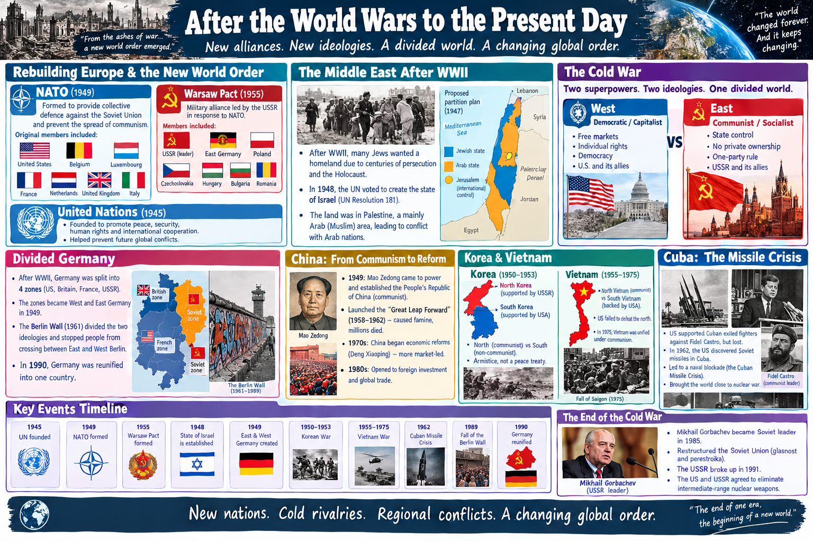
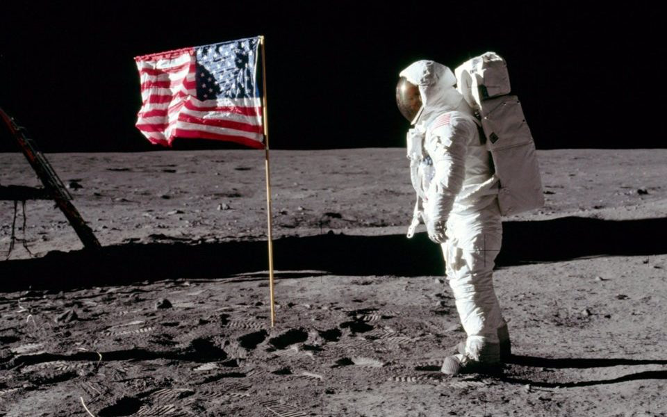
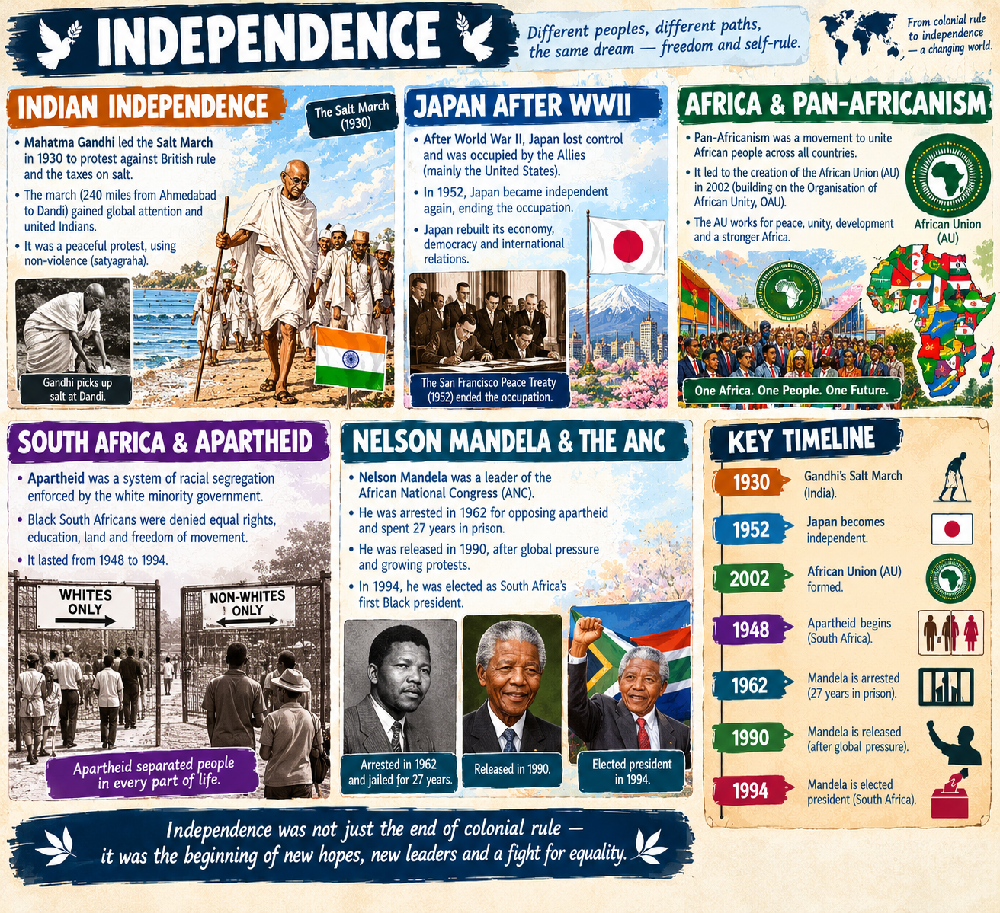
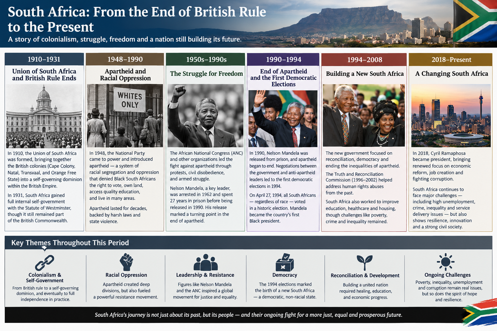
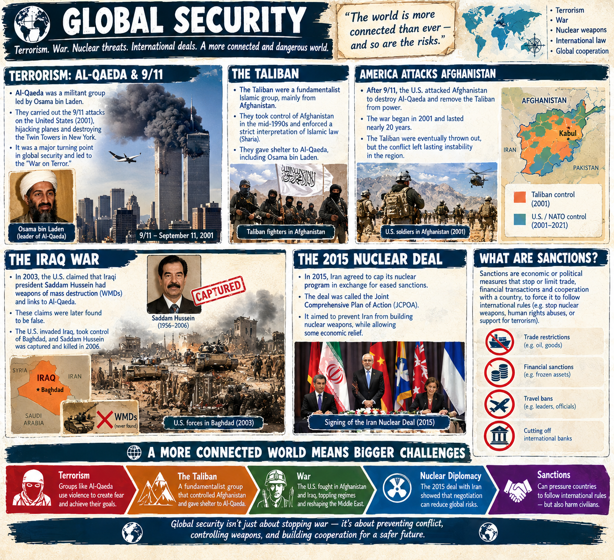

1945–1950
- End of World War II (1945) and the founding of the United Nations.
- Cold War begins between the United States and the Soviet Union.
- Partition of India (1947) and the creation of Israel (1948).
- Chinese Communist Revolution (1949) establishes the People's Republic of China.

1950s
- Korean War (1950–1953) ends in an armistice, dividing the peninsula.
- Space Race starts as the USSR launches Sputnik (1957).
- Civil Rights Movement gains momentum in the United States.
- Discovery of DNA's double-helix structure (1953) revolutionises biology.

1960s
- Cuban Missile Crisis (1962) brings the world to the brink of nuclear war.
- Apollo 11 Moon Landing (1969) puts the first humans on the lunar surface.
- Vietnam War escalates alongside massive global anti-war and counterculture protests.
- Decolonisation of Africa peaks as dozens of nations gain independence.

1970s
- Global Oil Crises (1973, 1979) trigger severe economic inflation.
- Watergate Scandal forces US President Richard Nixon to resign (1974).
- Vietnam War ends with the fall of Saigon (1975).
- Iranian Revolution (1979) establishes an Islamic Republic.

1980s
- Personal computers and early video games enter mainstream homes.
- HIV/AIDS epidemic emerges as a major global health crisis.
- Chernobyl nuclear disaster (1986) occurs in Soviet Ukraine.
- Fall of the Berlin Wall (1989) signals the collapse of European communism.

1990s
- Dissolution of the Soviet Union (1991) officially ends the Cold War.
- World Wide Web becomes publicly available, sparking the dot-com boom.
- End of Apartheid in South Africa with Nelson Mandela elected president (1994).
- Rwandan Genocide (1994) and the Yugoslav Wars devastate regions.

2000s
- 9/11 terrorist attacks (2001) launch the US-led War on Terror in Afghanistan and Iraq.
- Global Financial Crisis (2008) triggers the worst economic downturn since the 1930s.

NATO formed with countries: US, Belgium, Luxemborg, France, Netherlands, GB, Italy, 
Warshaw pact for Soviets
US didn't communism being spread. 
UN formed!
After ww2, Jews wanted a homeland. In 1948, UN mandate says to form the state of Israel in Palestine a mainly Arab(muslim) place.
west (democratic/capitalist) vs east(communism/socialist) idelologies
after ww2, germany was divided into 4 zones which became west and east germany. berlin wall was built to divide the two ideologies. 1990 it then combined into 1 germany.
china communism under Mao "great leap forward" of communes but it was a big failure -> famines. 
1970s, china reformed to be more market-led. 1980s became open to outside investment. 
korea and vietnma (communism vs non-communism)
    korea soviet supported the north and us the south. 
    vietnam us failed to beat the north vietnamese. now it's fully communist. 
cuba us supported exhiled fighters but lost. US discovered soviet missiles in Cuba leading to them blockading cuban missile crisis of 1962. 
cold war ended due to Soviet leader MIkhail Gorbachev restructured soviet union it broke up! Soviets and America agreed to eliminate intermediate range nuclear weapons. 

computers!
climate change
globalisation! process of making something worldwide
world organisations eg. UN, World trade organisation (WTO), EU
1969 Moon landing: Apollo 11 

# Independence

### Indian independence
indian independence: gandhi led the salt march in 1930 to protest the british and taxes on salt.
japan after ww2 became independent in 1952.

### South africa independence

Afrikaner (white british people who stayed in south africa) found largest diamond mine in the world. From British rule needed people to subjugate. Government made the apartheid to oppress black people.

South africa there were two tribes the Zulu and the Xhosa - when apartheid stopped in 1990 the question was which black tribe was going to take power. 
Nelson mandela, leader of ANC got arrested then got released in 1990. In 1994, he was elected as president. Later revealed that the apartheid government’s state security forces were covertly fueling the violence. They secretly funded and trained Zulu militias to attack the ANC in order to destabilize the liberation movement and weaken Mandela's bargaining power

Very similar to Sri lankan civil war. Instead of fighting a war of dominance like in Sri Lanka, Mandela used masterful diplomacy. He appeased Zulu nationalists by ensuring that the constitutional role of the Zulu King (the traditional monarch) would be respected and protected in the new constitution. At the very last minute, the Zulu agreed to drop its boycott and participate in the historic 1994 elections. Nelson Mandela was successfully elected president, and he immediately brought his Zulu rival, Mangosuthu Buthelezi, into his government as the Minister of Home Affairs to form a "Government of National Unity" and cement the peace

# Global security (2000-2008)

Terrorism by Al-qaeda 9/11. Taliban were the fundamentalist part in charge of afghanistan. America attacked afghanistan and taliban thrown out
America claimed Iraqi president(Saddam Hussein) had weapons of mass distruction + links to Al-qaeda.
US took over Bagdad, Iraq and Saddam killed.

