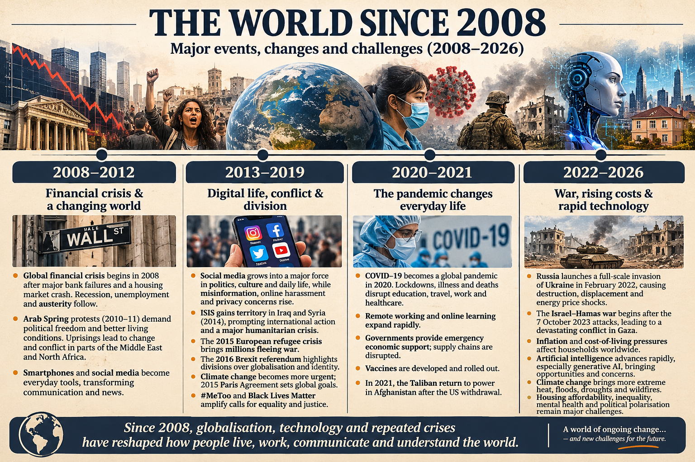

- Global Financial Crisis (2008) triggers the worst economic downturn since the 1930s.
- The first iPhone launched in 2007, and platforms like Facebook, YouTube, and Twitter grew into giants right as the economy
- Barack Obama is elected as the first African American US President (2008).
- Housing 
- COVID
- AI
- Social media
- Mental health
