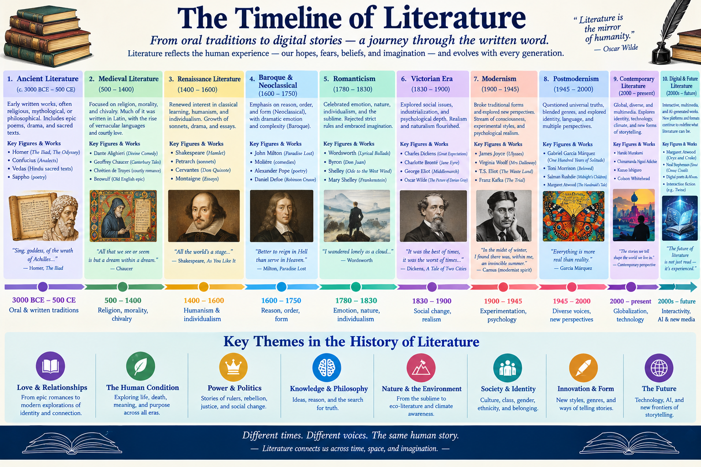

English language underpins much of modern western society. Which is why it is imperative you understand it. Most people have a rudimentary understanding of the language. First, remember to be a good writer you must be a good reader first.

**4 levels of reading** 
- Level 1: elementary (basic)
- Level 2: inspection: you are inspecting! detective work
- Level 3: analytical: best understanding of the book with unlimited time
- Level 4: synoptical: understand a topic overall

### Inspection level
1. What is the main idea?
2. What are the assertions?
3. Is book true in whole or part?
4. What of it?

### Analytical level
**Rules of reading**
1. Rule 1: You must know what kind of book you are reading, and you should know this as early in the process as possible.
2. Rule 2: State the unity of the whole book in a single sentence, or at most a few sentences. 
3. Rule 3: Understand the multiple units of the single unity and how they make one unity
4. Rule 4: Find out what the author's problems were
5. Rule 5: Find the important words and through them come to terms with the author. (Author has to understand the terms you want them to know)

### Synoptical reading
You understand an area of knowledge from multiple sources.

# Fiction and Non fiction

## Fiction. 
## Fiction genres
- Sci-fi: possibilities of future science or technology
- Adventure: thrills and action
- Fantasy: fiction that has elements of magic and supernatural
- Historical fiction: based on historical events but not facts
- Romance
- Mystery: centered on solving a puzzle, strange problem or crime
- Myth: cultural story involving supernatural characters
- Parody: imitates another piece of art to make fun of / a spoof
- Satire: humour to mock stupidity or corruption in the world
- Allegory: story that contains hidden meaning
- Realism: fiction stories that depict everyday life

Dramas
- One act play: one act
- Multi act plays: more than one act
- Screen plays: dramas that are intended for films or TVs

## Theme, Narration and Tone
A theme is a unifying idea in a piece of writing. It's not the topic, but rather how the author approaches the topic. Often it's what the narrator and characters are wrestling for in the story. The theme affects everything!

Theme: subject, or big idea in a piece of writing
How is the theme woven in the story?
- through sentences
- through plot, settings, characters
Engages with other aspects of the story
- impacts plots and characters
Many themes as possible
- importance of love and friendships
- dealing with loss
- importance of family
- learning to be a hero
- growing up
- coexistence of good and bad in the person/world
Examine these questions to find themes:
- what topic are the characters in the story struggling with?
- how do different scenes in this story convey same theme?
- what details does author use to represent the theme?

### Narration and Tone
Every author has a different background and experience. This includes culture, time period, location and personal experience. 
Narrator is the person who tells the story. The author creates the narrator. Think is the narrator reliable? Do they hide the truth? 

Tone is the way an author creates an attitude or mood in a piece of writing. 
Examples of tone: polite tone, whiny tone, angry tone, optimistic, hurt, compassionate, agitated, questioning, authoritative, hopeful, nervous

Authors use different tools to achieve a tone.
- Figurative language: means something different from its literal interpretation
    - figure of speech
    - irony
    - metaphor
    - personification
    - pun
    - simile
- Connotative language: words associated with
- Word choice: slight variations in word choice change tone
- Rhyme and repetition

## Settings
Setting is the surroundings and time in which the events of a story take place. The setting tells us the period, location, weather, surroundings of character and social characteristics. 
The author sets the scene: what you might see, hear, feel smell or taste. What big events have just happened. Where? When? What are the conditions?

- Geography: Continents, oceans, weather, and maps.
- Social: Governments, laws, money, and power structures.
- Culture and History: Religions, holidays, clothing, and past wars.
- Daily Life: Food, technology, architecture, and language.
- Magic laws: Explicit boundaries for what is scientifically or mystically possible

## Characters
Character is an individual in a story. 
Types of characters: main character, protagonist, antagonist 
Flat character: can be summarised in a few lines
Round character: lots of depth and detail characters
Sympathetic characters: characters we can relate to 
Dynamic character: changes during the course of the story
Narrator: can be a character in the story
Point of view
- First person narrator: 
- Second person: as it is happening to you. 
- Third person: character is not in the story - refers to the characters as “he” or “she”. Feels omniscient, which means the narrator knows all. 
Not all characters mean what they say, look for what they do. What they do might contradict their words and vice versa. 

Characters drive the plot by making choices and feeling emotions. They let us experience different lives and understand other people. Characters take action, face problems, learn lessons and show feelings. We feel close to the characters, we want to learn the truth of people, and curious how they fix hard problems. We also love magic.

## Plot
Plot is the sequence of events in a story. All the actions in a story build drama. All that action and dram build towards a resolution. 

freytag's pyramid
1. Exposition: author sets up the setting and explains what's going on
2. Rising action: a series of crises that lead to climax
3. Climax: the most exciting moment of a story, where both people and events change
4. Falling action: the events that follow climax
5. Resolution: the conclusion, in which all the tensions of the plot are resolved.

classic plots
- myths around the world
- traditional stories
- religious works from sacred texts
- adventures
- romances

how to build a plot: scenes
- storyboarding
- plot pyramid 

other parts:
- characters
- dialogue
- description

Plot – Set up
- Balance – the world in balance.
- Disruption – introduce event that throws things out of balance

 Plot - Conflict
- Facing obstacle: Main character faces the obstacles/conflict to restore balance
- Vulnerability: main character exposes internal fears, obstacles, mistakes
- What does my protagonist want in order to restore balance in his or her life? 
- What is keeping my protagonist from achieving his or her desire? 
- How would my protagonist decide to act in order to achieve his or her desire in the face of those antagonistic forces?
- What internal clash in logic does character experience? 

Plot - Resolution
- The Transformation: Reveal the outcome of the climax and how you changed.
- The New Normal: Show your updated reality and how it differs from the beginning.

## Non-fiction

## Non-fiction genres
- literary non-fiction: true stories (so can actually be interesting!)
- biographies: story of a life (factual)
- memoirs: memories with author's perspective
- journalism: report on truth/facts
- opinion pieces: share a person's opinion about a topic
- expositions: explain something
- arguments: state and defend a point of view
- essays: are short pieces of writing on a subject
- speeches
- epistles

## Narration
- what's the author's purpose? the reason an author sat down to write. What are they trying to convince the reader of something?

## Structure

The central idea is an idea that's at the core of the writing - it's the thing that keeps you reading.
When author presents details that explain the central idea - they are developing the central idea. 

- structure is the organisation of a text - or how the pieces fit together. some common structures:
    - compare and contrast structure
    - chronological structure
    - process structure
    - cause and effect structure
    - problem and solution structure
    - description structure

