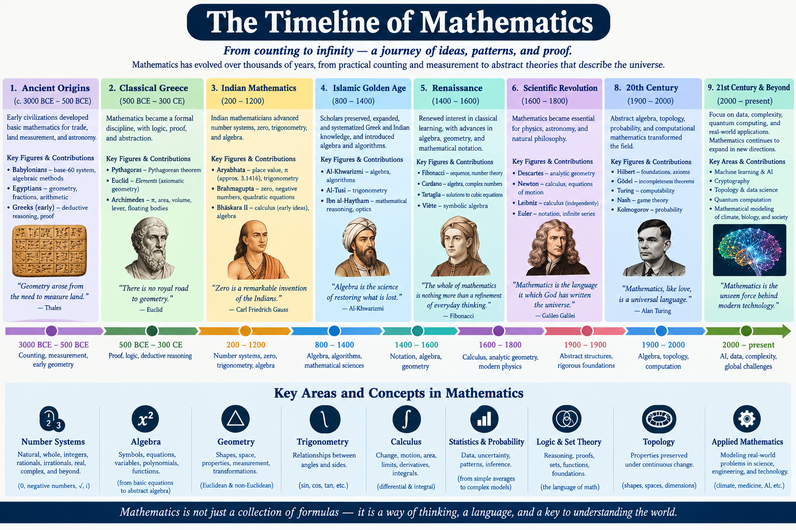
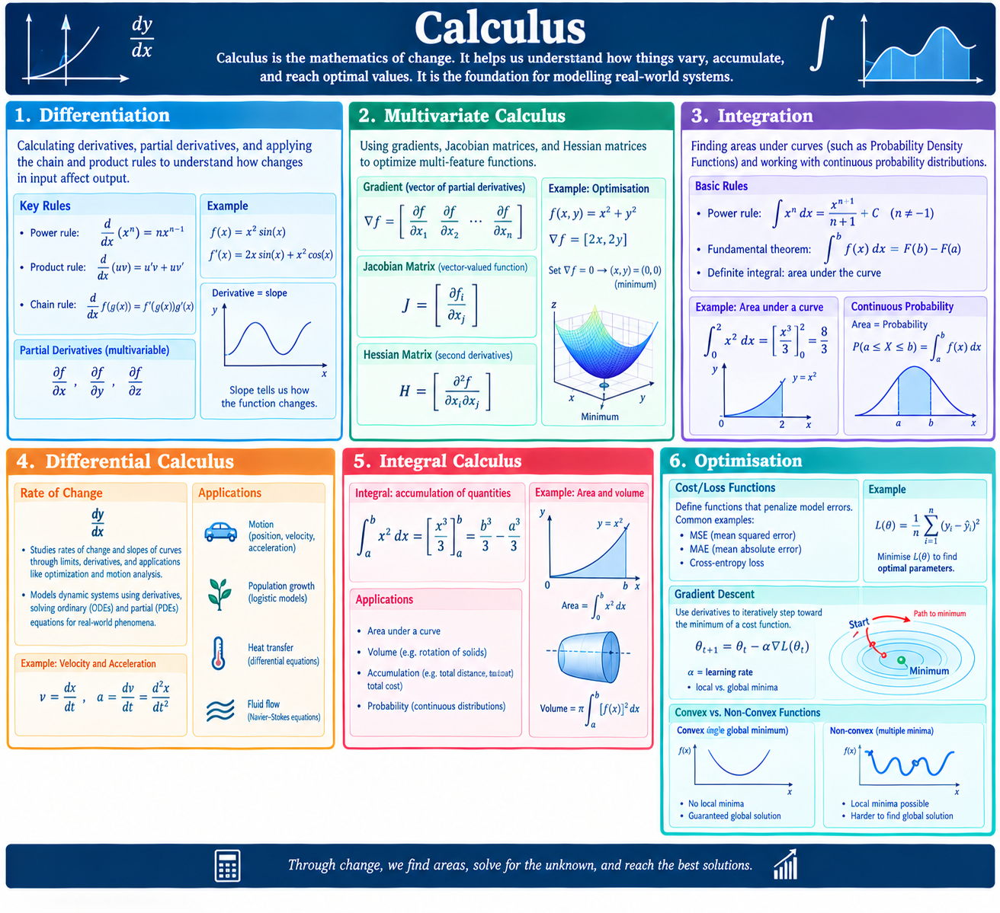

Mathematics is the rigorous and systematic study of patterns, quantities, structures, space and change. 
* [arithmetic](#arithmetic): numbers and operations
* [algebra](#algebra): replace with symbols
* [geometry](#geometry): physical space to analyse shapes
* [calculus](#calculus): change and accumulation
* [stats](https://d3-s0.github.io/jekyll/update/2000/01/01/maths-2.html): data analysis for insights

## Arithmetic
Arithmetic is the branch of mathematics for manipulation of numbers.
- number types: natural, whole, integers
- prime factorisation
- number bases and conversions
- estimation and rounding

## Algebra
Algebra generalises arithmetic by introducing variables and symbols to represent numbers.
- expressions
- solving equations
- inequalities
- functions

**Linear algebra**
Linear algebra studies vector spaces and linear mapping between them, using vectors, matrices, determinants, eigen values and eigen vectors.

- Vectors: Ordered lists of numbers that represent both magnitude and direction. 
- Matrices: Rectangular arrays of numbers used to store data or represent linear transformations. The transformation takes a vector and makes it into another vector.

- Data Structures: Representing tabular data, images, text, and neural network weights as scalars, vectors, matrices, and tensors.
- Matrix Operations: Performing addition, subtraction, transposition, dot products, and matrix multiplication.
- Linear Transformations & Systems: Solving linear equations using matrix inverses, determinants, and row reduction.
- Decompositions & Eigen-stuff: Applying eigenvalues, eigenvectors, Singular Value Decomposition (SVD), and Principal Component Analysis (PCA) for dimensionality reduction

## Geometry
Geometry looks at properties, relations and measure of points, lines, surfaces, and solids in space, focusing on shapes, size, relative position, and dimension.

Euclidean geometry: classical geometry
- points, lines 
- triangles
- circles
- polygons
- areas, perimeters

Coordinate geometry
- Cartesian coordinate system to describe shapes algebraically
- distance, midpoint
- intersection and tangency 
- transformation of coordinates and conic sections

## Calculus

Formalises study of continuous change - rates of change and accumulation.
- Differentiation: Calculating derivatives, partial derivatives, and applying the chain and product rules to understand how changes in input affect output.
- Multivariate Calculus: Using gradients, Jacobian matrices, and Hessian matrices to optimize multi-feature functions.
- Integration: Finding areas under curves (such as Probability Density Functions) and working with continuous probability distributions

###  Differential Calculus
- Differential: rate of change: dy/dx Studies rates of change and slopes of curves through limits, derivatives, and applications like optimization and motion analysis. 
- Models dynamic systems using derivatives, solving ordinary (ODEs) and partial (PDEs) equations for real-world phenomena.

###  Integral Calculus
- Integral: accumulation of quantities ∫_a^bx^2  dx

### Optimisation
- Cost/Loss Functions: Defining mathematical functions that penalize model errors.
- Gradient Descent: Using derivatives to iteratively step toward the minimum of a cost function (learning rate, local vs. global minima).
- Convex vs. Non-Convex Functions: Identifying whether an optimization problem guarantees a single global solution

