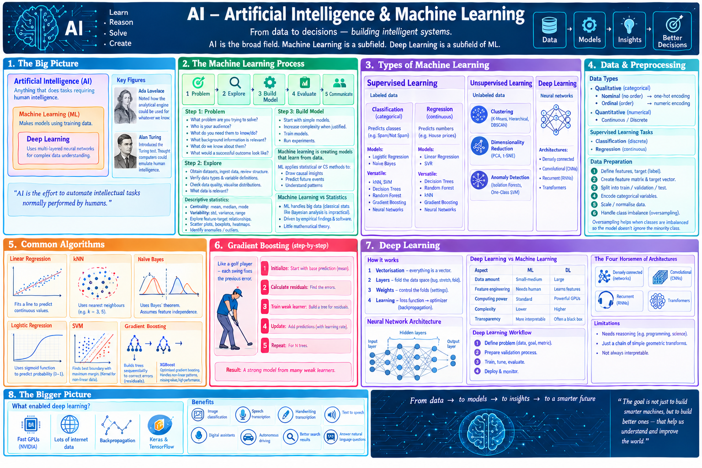
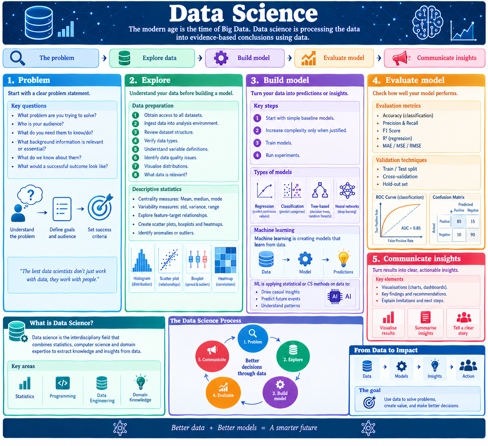

# Programming
Programs are just a sequence of instructions telling a computer what to do. The problem with human language is that it’s ambiguous. We only understand each other because we share a lot of common knowledge and experience. Even then we struggle with communication. Computers require clear instructions on what to do. Computer scientists circumvented this problem by making special notations for everything that can be computed – called programming languages. Every structure in programming languages has a precise form (syntax) and precise meaning (semantics). These languages are called High level programming languages because they are designed for humans.  Computers though can only understand machine language and eventually in binary.

### Basics - variable, types, operators
Variables= Holds the data
Data types
- Types: int, floats, string, Boolean, char, null or none, 
- Data structures
- Lists or arrays
- Dicts or maps
- Sets (unique values)

Operators
- Arithmetic (=,+,-,)
- Comparison (<,>)
- Logical (and, or)

### Control - if, for, while

#### Conditional – if
- Aim: minimize the number of checks the computer performs:
- Place the most likely case first: Put the condition most likely to be true at the top of an if/elif chain so Python can skip subsequent checks immediately.
- Put "cheap" checks before "expensive" ones: Evaluate simple comparisons (e.g., x == 0) before complex ones like function calls or database lookups.
- Avoid deep nesting: Use the "Guard Clause" pattern—exit early from a function if a condition isn't met—to keep code flat and avoid redundant evaluations.

#### Loops (for, while)
- Over a list of values
- Range()  builds a sequence of numbers
- List() makes it into a list
- Loops – efficient for loops
- To make loops efficient in Python, the best strategy is often to  avoid them entirely by using built-in functions or vectorization. If you must use them, you should minimize "overhead"—the extra work Python does to look up variables and function

### Data storage - lists, dicts, 
- Lists or arrays
- Dicts or maps
- Sets (unique values)
- Data structures - lists
- Encryption : the process of encoding information for the purpose of keeping it secret or transmitted it privately is called encrypton. 
- To decrypt a. message- party receiving the message needs o have a key so encoding can be reversed.  Keys can be public or private. 
- Public systems – encryption keys are public – anyone can send a messge using key but only the other part will have decryption key to decipher it. 
- Files – text files can be iterated through lines wih a for flop  using read, readline, readlines
- Simple version of program or program component and try to gradually add features until it meets spec 
- Mini cycles through the dev process as prototype is incrementally expanded into final program
- Data structures - Dictionaries
- Editing Dictionaries
- Replacing a value

### Functions

Lets you repeat instructions - reusable instructions

### OOP

- OO approach – see complex system as a series of simpler objects. 
- Objects contain data + operations (do stuff). Objects can refer to other objects. 
- What is an Object?
- An object is an instance of a class and consists of:
- State  the properties or data of the object (e.g., instance
- variables like `self.data`).
- Behavior  the methods (functions) the object can perform.
- Identity  each object has a unique identity (memory address),
- even if its contents are the same as another object.
- The `__init__` Method
- When creating an object, the `__init__` method initializes instance
- attributes, which are specific data attached to each object.

-	Essence of design is describing a system in terms of magica black boxes and htei interfaces. Other components are users or clients of the services
-	Black box just has to make sure the service is faithfully delivered. Separation of concern is what makes deisgn of comple sysems possible.
-	Magic behind objects lies in class definition. Once a suitable class definition has been written we can ignore how the class works. Just rely onexternal interface – the methods. 
-	We don’t need to know all the way to the bottom to use the class. 
-	Most computer programs are built using OO approach – see complex system as a series of simpler objects.  Objects contain data + operations (do stuff). Objects can refer to other objects.
-	Create a new instance a class – constructor. object_anme = Class_name(param)
-	To perform an operation on the object we send the object a message. Object.(method). Every object is an instance of some class. It is the class that determines what method an object will have. 
-	We have to avoid aliasing where two variables refer to the same object. Use a clone instead. Methods that change the state of an object are called mutatrors
-	Object oriented design
-	Essence of design is describing a system in terms of magica black boxes and htei interfaces. Other components are users or clients of the services
-	Black box just has to make sure the service is faithfully delivered. Separation of concern is what makes design of compile systems possible.
-	Magic behind objects lies in class definition. Once a suitable class definition has been written we can ignore how the class works. Just rely onexternal interface – the methods. 
-	We don’t need to know all the way to the bottom to use the class 
-	Encapsulation
-	Polymorphism

 

# How computers work

#### CPU
At the heart of every computer is an integrated circuit called a CPU. It communicates with the computer's main memory, input devices, and output devices. 

The CPU is the brain of the computer, responsible for general-purpose computing. It contains billions of transistors, which act as tiny switches representing binary data (1 and 0). The CPU performs tasks in multiple steps: 
1.	fetching - control unit receives instruction from memory
2.	decoding - control interprets the instruction
3.	execution - ALU performs calculation
4.	repeating 1-3
The CPU's speed, measured in gigahertz (GHz) indicates how many instructions the CPU can perform in a second.  More cores mean you can do multiple tasks at once. 
 
Sand to transistor
But what is this transistor?
A transistor is a three-terminal semiconductor device with the collector, base, and emitter. By applying a small current to the base, a larger current flows between collector and emitter. This switching represents binary states. In a modern CPU, binary logic is primarily formed using MOSFETs (Metal-Oxide-Semiconductor Field-Effect Transistors)
Transistors act as microscopic, high-speed switches that represent binary states (1 for "on" and 0 for "off"). By combining several transistors, engineers create Logic Gates, which perform basic mathematical and logical operations. NOT Gate: Inverts the signal (1 becomes 0). AND Gate: Outputs 1 only if both inputs are 1. OR Gate: Outputs 1 if at least one input is 1. NAND/NOR Gates: These "universal" gates are particularly efficient to build with MOSFETs and can be used to construct any other type of logic. 
How do you make a transistor? Sand.
The most common form of sand is silicon dioxide (SiO₂), found in quartz.
Silicon is the second most abundant element in Earth’s crust, and sand provides a cheap, plentiful raw source. Raw sand can’t be directly used for chips. It first goes through chemical reduction processes (like the carbothermic reduction in a furnace) to make metallurgical-grade silicon (~98–99% pure). That silicon is purified further via the Siemens process into extremely pure polysilicon (99% pure, or “9N” purity). This step is critical — impurities at parts per billion can make chips fail. Using the Czochralski process or float-zone refining, the pure polysilicon is grown into large, single-crystal silicon ingots. These ingots are sliced into thin wafers — the starting substrate for chips. On the wafer, layers of materials are deposited, patterned, and etched using processes like photolithography, doping, oxidation, and etching.
Billions of transistors are created on each wafer. 
 

#### RAM
RAM comes in sizes like 4gb, 8gb, 16gb, and 32gb, and it is essential for temporary data storage during active tasks.
PSU
The PSU converts electrical power from your home's AC outlet into direct current (DC) that your PC components require. Efficiency is important because it determines how much power is converted to DC.
Storage
For storage, Solid state drive (SSD) uses flash memory to store data even when  power is off. Unlike hard drives, SSDs have no moving parts, making them faster and more durable. Case sizes come in sizes corresponding to the motherboard form factors, such as  micro-ATX, ATX and E-ATX.
GPU
The GPU renders images and videos. It has many cores and dedicated memory for processing graphics, making it excellent at parallel processing. Popular GPU brands are NVIDIA, AMD and Intel.

#### Motherboard	
The motherboard is like the skeleton of the PC, connecting all the "thinking" units together. Motherboards comes in three different sizes: ITX, Micro ATX and ATX. There are two main motherboard brands based on CPU brand: AMD and Intel withs specific socket types. Case sizes come in sizes corresponding to the motherboard form factors, suchas micr-ATX, ATX and E-ATX.
 

# AI

Artificial Intelligence (AI) is a broad field which captures anything that does tasks requiring human intelligence. Machine Learning (ML): A subfield of AI, that makes models using training data.

- Deep Learning: A subfield of ML - uses multi-layered artificial neural networks for complex data understanding. 
- AI is the effort to automate intellectual task normally performed by humans. 
- Ada lovelace remarked how the analytical engine could be used for whatever we know

- Alan turing introduced the turing test. He thought computers could emulate all aspects of human intelligence

Machine learning looks at the input data and answers, figures out what the rules/patterns should be
- Machine learning vs statistics
- Machine learning deals with big data – for which classical stat analysis such as Bayesian analysis would be impractical.
- ML is driven by empirical findings and advanced software
- ML has little mathematical theory

The modern age is the time of Big Data. Data science is processing the data into evidence-based conclusions using data. 

Build model
- Start with simple baseline models.
- Increase complexity only when justified.
- Train models.
- Run experiments.
- Machine learning is creating models that learn from data. 
- ML is applying statistical or CS methods on data to:
- Draw casual insights 
- Predict future events
- Understand patterns

 Evaluate model
Assess performance metrics.
- Categorical (Classification)
- Confusion matrix
- Accuracy 
- Precision 
- Recall
- F-score
- Area under curve
- Log loss
- Continuous (Regression) 
- Absolute error
- Squared error
- Measured square error
- Root mean square error
- Absolute error distribution
- Residual sum of squares

Machine learning needs 3 things:
- Input data points
- Examples of expected outputs
- Way to evaluate performance of model
- Machine learning is learning useful representations of input data, that get us closer to expected output

Supervised 
Categorical (Classification Models) – predicts categories
Predicts discrete labels or classes (e.g., Spam vs. Not Spam).
Primary Models: Logistic Regression, Naïve Bayes.
Versatile Models: kNN, SVM, Decision Trees, Random Forest, Gradient Boosting, Neural Networks.
Continuous (Regression Models) – predicts numbers
Predicts numerical, real-valued outcomes (e.g., House Prices).
Primary Models: Linear Regression, SVM Regression (SVR).
Versatile Models: Decision Trees, Random Forest, kNN, Gradient Boosting, Neural Networks. 

Categorical (Classification Models)
Classification models are used when the goal is to predict a discrete labelor category. For example, determining if an email is "Spam" or "Not Spam". 
Primary Models (Strictly for Classification):
Logistic Regression: Despite its name, it is a classification tool. It calculates the probability (0 to 1) that an input belongs to a specific class.
Naïve Bayes: Based on Bayes' Theorem, it assumes all input features are independent. It is exceptionally fast and often used for text and sentiment analysis.
Versatile Models (Used for Classification):
k-Nearest Neighbors (kNN): Classifies a new data point based on the majority label of its "K" closest neighbors in the dataset.
Support Vector Machines (SVM): Finds the best boundary (hyperplane) that separates different classes with the widest possible margin.
Decision Trees: A flow-chart-like structure where each "node" represents a choice based on data features, leading to a final classification.
Random Forest: An "ensemble" method that builds many decision trees and combines their results (majority vote) to improve accuracy.
Gradient Boosting: Builds trees sequentially, where each new tree specifically tries to correct the errors made by previous ones.
Neural Networks: Complex layers of "neurons" that mimic the human brain to find patterns in massive datasets, like recognizing faces in images. 
2. Continuous (Regression Models)
Regression models predict a numerical value rather than a category. For example, predicting a house's price might be 450,000. 
Primary Models (Strictly for Regression):
Linear Regression: Fits a straight line through data points to find the relationship between inputs and a continuous numerical output.
SVM Regression (SVR): A version of SVM that finds a boundary containing as many data points as possible within a specific error range.
Versatile Models (Used for Regression):
Decision Trees & Random Forest: Instead of a class label, the "leaf" of the tree provides the average value of the data points in that group.
kNN: Predicts a value by taking the average (mean) of the values of the "K" nearest neighbors.
Gradient Boosting: Sequentially adds trees to minimize the overall prediction error of numerical values.
Neural Networks: Use their complex layers to map inputs to a specific, real-world numerical output, such as weather forecasting or stock trends. 

##### Supervised learning
Features – Qualitative data  – categorical data
Nominal data (no inherit order within data)
Nominal -> one hot encoding -> computer
If matches category make 1 otherwise make 0
Ordinal data (inherit order)
Give good/bad numbers for the order
Quantitative data
Numbers 
Supervised learning tasks
Classification – predict discrete classes
Regression – predict continuous values
Preparing the data
Column – features
Output label – target for feature vector
Feature vector – all features in one sample – one row
All data is feature matrix
Target vector
Each row is fed into model
Plot the features against target to see the data
We don’t want to feed our model all the data
Training dataset
Validation dataset
Testing dataset
Preparing data
We need to make target a number not a string
Can encode it
Then view the data
Split the data into train, val, test
Normalise data using scaler
Preparing the data

Scale the data so data is normalized to the data in that column
You may need to oversample your training data if the
You oversample when class counts are very different so the model does not “ignore” the minority class and become biased toward the majority class.
With imbalanced data, a classifier can get high overall accuracy by mostly predicting the majority class, while performing very poorly on the minority class

##### Linear regression
kNN
Euclidean distance = length of point to neighbours
K = how many neighbours we use to judge  e.g. 3,5 
we find the 3 closest points and base of the majority of those

##### Naïve Bayes
Naive Bayes is a machine learning classification algorithm that predicts the category of a data point using probability. It assumes that all features are independent of each other.
The main idea behind the Naive Bayes classifier is to use Bayes' Theorem to classify data based on the probabilities of different classes given the features of the data.
The algorithm is "naive" because it makes one huge assumption: all features are independent of each other
he foundation of Bayes theorem is conditional probability 
Logistic regression

It is a type of classification algorithm that predicts a discrete or categorical outcome.
Logistic regression model transforms the linear regression function continuous value output into categorical value output using a sigmoid function which maps any real-valued set of independent variables input into a value between 0 and 1
Logistic regression then applies the sigmoid function to zto convert it into a probability between 0 and 1 which can be used to predict the class.
Support Vector Machine (SVM)

Plot your data points.
Find the boundary that keeps the biggest distance from the closest points.
Use a "Kernel" to warp the space if a straight line won't cut it.
Gradient boosting
Gradient Boosting like a golf player trying to sink a hole-in-one.
The First Swing: You take a shot. It’s not great; the ball lands 50 yards away from the hole.
The Feedback: You don't start over. Instead, you look at the gap (the error) between the ball and the hole.
The Correction: You take a second, smaller swing specifically designed to cover that 50-yard gap.
Repeat: If you're still 5 yards off, your third swing is just a tiny tap to fix that specific mistake.
Gradient Boosting builds them one by one. Each new tree is specifically designed to correct the errors (called residuals) of the entire ensemble created so far. 
How the Algorithm Works (Step-by-Step)
Initialize the Model: Start with a simple "base" prediction, which is typically the mean of the target values for regression.
Calculate Residuals: Find the difference between the actual values and the current model's predictions.
Train a Weak Learner: Build a new decision tree that predicts these residuals instead of the original target.
Update Predictions: Add the new tree's predictions to the existing model, scaled by a learning rate (also known as "shrinkage") to prevent overfitting.
Repeat: Iterate through steps 2–4 for a set number of trees (e.g., 100 or 1,000). 
Gradient boosting
XGBoost fits prominently in the gradient boosting category of the ML world
handles non-linear patterns, interactions, and missing values natively
XGBoost, short for eXtreme Gradient Boosting, is a highly optimized implementation of gradient boosting machines in machine learning. It excels as an ensemble method that builds sequential decision trees to correct errors from prior trees, delivering top-tier performance on structured/tabular data
 
##### Unsupervised 
The model analyzes unlabelled data to identify hidden patterns, structures, or groupings without human guidance
Clustering: Groups similar data points together.
Techniques: K-Means, Hierarchical Clustering, DBSCAN. 
Dimensionality Reduction: Simplifies large datasets by compressing features while retaining critical information.
Techniques: Principal Component Analysis (PCA), t-SNE.
Anomaly Detection: Identifies rare items or unusual observations that deviate from the norm.
Techniques: Isolation Forests, One-Class SVM
 
##### Deep learning

- Deep stands for successive layers of representation
Layered representation are learned via models called neural networks
Deep learning does input-target mapping via deep sequence of simple data transformations (layers)
Neural network is a bad name -> layered representations learning
A neural network architecture is the layered structure of interconnected artificial neurons (nodes) that process data, typically consisting of an input layer, one or more hidden layers, and an output layer, meaning is derived from pair-wise relationship between things (between words in a language)
Vectorisation
Everything is a vector – point in geometric space
Vectorisation: E.g. Cat and dog pics become dots floating in a giant room. 
The problem is they are all mixed up. We can’t separate them.
Target space
We want the dog dots on one side and cat dots on other side
Layers (the folding)
Each layer is like a hand that goes in and moves the space e.g. tug, stretch, fold
Weights are how hard to pull or where to fold (”Settings”)
Learning (The correction)
At first, it’s a bit retarded and gets it wrong -> we then tell it got it wrong via the Loss function
The adjustment (gradient descent): because it’s differentiable, we can see which fold got it wrong. We chang the weights by a bit to make fold better
Rinse and Repeat, until folds are perfect

Loss score to optimizer
The trick is using the loss score to adjust he weights that will lower the loss score 
The adjustment is the job of the optimizer which carries out the backpropagation algorithm
Deep learning vs Machine learning 
ML is used on small amounts of data while DL needs a lot of data
ML needs human to point out important features
DL needs powerful GPUs
DL is often a black box 
Deep learning workflow
Define the problem: What data is available? What are you trying to predict?
How to measure success?
Prepare validation process that you’ll use to evaluate the models. 
The four horsemen of architectures
Densely connected networks
Convolutional networks
Recurrent networks
Transformers
Limitations of deep learning
Anything that requires reasoning e.g. programming, scientific method
Deep learning is just a chain of simple, continuous geometric transformations 
What enabled deep learning?
Fast GPUs (NVIDIA)
Lots of internet data
Backpropagation
Keras and tensorflow
Deep learning benefits
Near human level image classification
Near human level speech transcription
Near human level hand writing transcription
Text to speech conversion
Digital assistants
Automonous driving 
Improved search results
Ability to answer natural language questions

