Having worked in the Energy Modelling sector for a while, I thought it would be useful for me to write about it. Energy Modelling is the simulation of a building’s energy using physics to estimate energy consumption. 

Building energy modelling comes in 2 main forms: steady state vs dynamic simulation modelling. 

Steady state is typically a simple monthly calculation whereas dynamic simulation modelling is the more advanced form where there are heat balance calculations.

What are the benefits of BEM?
- Demonstrate compliance with building regulation (government)
- Stock modelling helps inform energy efficiency policies (government)
- Make informed decisions about energy performance (developers and owners)
- Identify the most effective energy conservation measures and technologies for a specific building (retro-fitters) 

1. [Dimension inputs](#dimension-inputs)
2. [Ventilation](#ventilation)
3. [Heat loss](#heat-loss)
4. [Internal gains](#internal-gains)
5. [Solar gains](#solar-gains)
6. [MIT](#mit)
7. [Space heat demand](#space-heating-demand)
8. [Space heating system](#space-heating-system)
- [heat pump](#heat-pump)
- [boiler](#boiler)
9. [Water heating demand](#water-heating-demand)
10. [Renewable](#renewable)
11. [Total and Energy sector](#totals-and-energy-sector)

# Dimension
ground_floor_area = 40
first_floor_area = 40
ground_floor_storey_height = 2.5

RdSAP - Heights are measured internally within each room, and 0.25 m is added by software to each room height except for
the lowest storey, to obtain the storey height.
first_floor_storey_height = ground_floor_storey_height + 0.25

Calculations
TFA = ground_floor_area + first_floor_area
ground_V = ground_floor_area * ground_floor_storey_height
first_V = first_floor_area * first_floor_storey_height
Dwelling Volume =  ground_V + first_V

Inputs
RdSAP - The area of an external door is taken as 1.85 m². A door to a heated access corridor is not included in the door count.
solid_door_area = 1.85

 RdSAP The U-value of insulated doors is part of the data set; the U-value of other external doors is taken from Table 15A.
solid_door_u_value = 3
doors_2 = solid_door_area * solid_door_u_value

RdSAP -The U-value of windows and the solar transmittance of glazing is taken from Table S14.
window_inital_u = 3.1

Table S3 : Wall thickness (mm) age band C and solid brick
wall_thickness = 0.220

ground_exposed_perimeter = 10.0     # RdSAP - Input Exposed perimeter in m
first_exposed_perimeter = 10.0

u_value_windows = 1/((1/window_inital_u)+0.04)

windows = window_area * u_value_windows

total_area_of_external_elements = solid_door_area + window_area + roof_area + (gross_wall_area-openings_area) + ground_floor_area 

party_wall_heat_loss = party_wall_area * party_wall_u_value

fabric_heat_loss = doors_2 +windows + ground_floor + walls +roof +party_wall_heat_loss

thermal_bridges = 0.15 * total_area_of_external_elements
total_fabric_heat_loss = fabric_heat_loss + thermal_bridges
ventilation_heat_loss = [0.33 * ach * DV for ach in effective_ach]
HTC = [vent + total_fabric_heat_loss for vent in ventilation_heat_loss ]
HTC_avg = sum(HTC) / len(HTC)
HLP = [HT / TFA for HT in HTC ]

## Floors
## Walls
## Ceiling and Roofs
## Doors
## Windows

# Infiltration and Ventilation
if has_test:
    if ap50 > 0:
        adjusted_infiltration = (ap50 / 20) + infiltration_rate
    else:
        adjusted_infiltration = (0.263 * (ap4 ** 0.924)) + infiltration_rate

## Mechanical ventilation

The main types of continuous mechanical ventilation systems are:

- Centralised Mechanical Extract Ventilation (MEV)
- Centralised Mechanical Ventilation with Heat Recovery (MVHR)
- Decentralised Mechanical Extract Ventilation (dMEV)
- Decentralised Mechanical Ventilation with Heat Recovery (dMVHR)

**Centralised Mechanical Extract Ventilation (MEV)**

MEV is an extract ventilation system that operates continuously at a low air flow rate. It operates by removing stale air out of wet rooms (bathrooms and kitchen). Fresh air enters the dwelling via air bricks, window vents and gaps in the dwelling.

- Have a single central extractor fan unit mounted in the loft or a cupboard.
- The central unit is connected via ductwork to extract air from multiple wet rooms like bathrooms, kitchens, and utility rooms.
- Air is drawn from these rooms through ducts installed in the walls and expelled outside through a single vent.
- Provide simultaneous extraction from up to 6 wet rooms.
- Require proper ducting installation throughout the property.

**Decentralised MEV Systems**
dMEV systems work similarly to centralised MEV, the main difference is that separate fans are installed directly in the wet rooms instead of one centralised unit.
- Have multiple individual extractor fans installed directly in each wet room.
- No ductwork is required as each fan extracts air directly from that room.
- Fans are usually mounted on the wall or ceiling of the wet room.
- Each room's extraction is independent and not connected to a central unit.
- Offer more flexibility in installation as no ducting is needed.

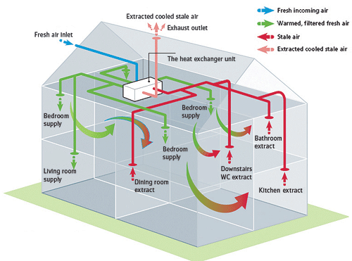

**Mechanical Ventilation with Heat Recovery (MVHR)**

While MEV systems extract stale air and expel it outside, MVHR recover the heat from the stale air and use it to prewarm fresh air entering the house.

1. Fresh air
    - The process begins with fresh outdoor air entering the house which gets filtered to remove impurities. The air is taken to the heat exchanger.
2. Heat exchanger
    - The heat exchanger is the main component of the MVHR, this is where the fresh air is preheated using heat from the extract air.
    - The preheated air is passed through a fan that pushes the air to a heating coil which heats up the prewarmed air to the desired temperature. This uses less energy as the air is warmer than the outdoor temperature that would have been used.
    - The control system determines the fan speeds based on data about the indoor air quality, temperature and humidity.
3. Supply air
    - The conditioned supply air then channelled through the ductwork into various rooms via vents.
4. Extract air
    - Stale warm air is then extracted from wet rooms to the heat exchanger.
    - The heat from the stale warm air that would have otherwise been wasted is recovered when it is passed through the heat exchanger.
5. Exhaust air
    - The now cold and stale air is expelled from the building using a dedicated exhaust fan.

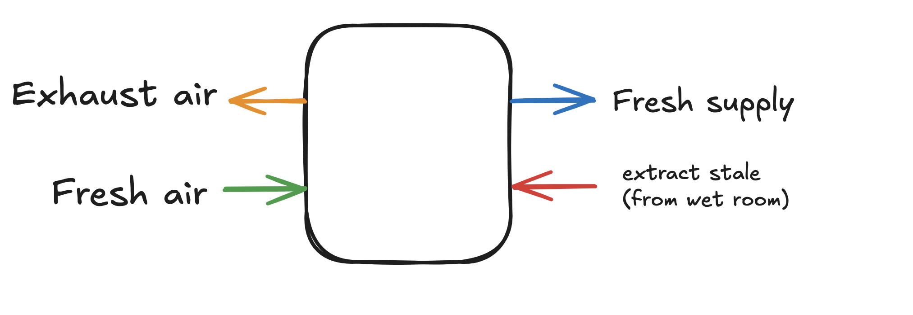

air flow rate
Modern homes are built to be highly airtight to save energy. However, human activity constantly spoils the air inside.
A flow rate (measured in litres per second, or l/s) is simply the speed at which stale air is pushed out and fresh air is brought in to fix this problem. One litre of air is roughly the volume of a standard plastic bottle. If a fan runs at 15 l/s, it is moving 15 "bottles" of air every single second.
To keep air flowing correctly, air moves from the "Clean/Dry" rooms, under internal doors (which usually have a small 10mm gap at the bottom), and into the "Dirty/Wet" rooms to replace the air being sucked out.
If you extract 50 l/s total from your kitchen and bathrooms on boost, a proper system (like an MVHR system) must simultaneously supply 50 l/s of fresh air to your bedrooms and living room. If it doesn't balance, the house experiences negative pressure, making it harder for doors to open and causing cold drafts to pull through tiny cracks in the building structure.
- A tiny downstairs WC only needs a trickle of 6 l/s.
- A bathroom during a shower needs a boost to 15 l/s.
- A kitchen during heavy cooking needs a powerful boost of 30 to 60 l/s.
When you add up all the rooms in a typical 2-to-3 bedroom home, the sweet spot for the entire system's operational capability almost always sits comfortably between 10 l/s (when the house is empty on low trickle) and 50 l/s (when multiple people are home, showering, and cooking on boost).

# Heat loss

# Internal gains

Appliances gains calculations
EA_initial = 207.8 * (TFA * N)**0.4714
monthly_energy = []
monthly_heat_gain_appliances = []
for m in range(1, 13):
    # (L11)
    EA_m = EA_initial * (1 + 0.157 * math.cos(2 * math.pi * (m - 1.78) / 12)) 
    EA_m *= days_in_month[m-1] / 365
    monthly_energy.append(EA_m)
    # (L13)
    GA_m = EA_m * 1000 / (24 * days_in_month[m-1])
    monthly_heat_gain_appliances.append(GA_m)
EA_recalculated = sum(monthly_energy)

Lighting gains calculatuons
LLE = 16    # low-energy outlets
L = 16    # total fixed outlets
window_data = [
    {'Aw': window_area, 'gL': 0.76, 'ZL': 0.9, 'FF': 0.7}
]

# Solar gains

U3 and U4 data for UK Average
uk_avg_horizontal = [26, 54, 96, 150, 192, 200, 189, 157, 115, 66, 33, 21]  # W/m²
solar_declination = [-20.7, -12.8, -1.8, 9.8, 18.8, 23.1, 21.2, 13.7, 2.9, -8.7, -18.4, -23.0] 
uk_latitude = 53.5
East/West constants from Table U5
k1, k2, k3 = 1.44, -2.36, 1.07
k4, k5, k6 = -0.514, 1.89, -1.64
k7, k8, k9 = -0.542, -0.757, 0.604
pitch = 90  # Vertical window
access_factors = 0.9

# MIT
External temperature
Te = [4.3, 4.9,	6.5	, 8.9, 11.7,14.6,16.6,16.4, 14.1,10.6,7.1,4.2]

Heat requirement calculation
L = HTC[i] * (final_MIT - Te[i])
Loss_rate.append(L)

useful_gains = total_gains[i] * η_final
useful_gains_all.append(useful_gains)

Space_heating_req = 0.024 * (heat_loss_MIT - useful_gains) * number_days
Q_heat = 0.024 * (L - useful_gains)*days_in_month[i]

main2_frac = 0
secondary_frac = 0
 Adjustments from table D2.7 row D1.5 - regular modulating boiler Sime Ecocomort System 25 HEand D1.9 for combi
nSAP = 89.1
nwinter = nSAP + 0.9
nsummer = 87 # from database

space_heating_fuel_main1 = [ req * main1_frac /eff_main1_space_system for req in space_heat_final] 
space_heating_fuel_main2 = [ req * main2_frac/eff_main2_space_system for req in space_heat_final] 
space_heating_fuel_secon = [ req * secondary_frac/eff_second_main_system for req in space_heat_final] 

# Space heating demand

# Space heating system
### Boiler 
1. Natural Gas delivery
    - Natural gas is sourced, extracted, and delivered to buildings through an extensive network of pipelines that cover long distances.
2. Combustion chamber
    - Once the gas is inside the building, it’s transported to the boiler’s combustion chamber where the combustion process is carried out.
    - When natural gas is mixed with oxygen and ignited, it creates a flame, and thus the desired heat.
    - The process also creates waste gases in the form of hot water vapour and carbon dioxide.
    - Most modern combi boilers feature a modulating burner which can adjust its output for the demand.
    - The heat created by flame is transmitted to the primary heat exchanger.
3. Primary heat exchanger
    - The primary heat exchanger consists of copper pipes which carry water in parallel lines to capture as much of the heat from the gases as possible.
4. Circulation pump
    - An electric circulation pump circulates the water throughout the heating system.
5. Space heating
    - For space heating, hot water flows into the radiators when Thermostatic radiator valves (TRVs) are turned up.
    - The water, having released heat into the room, returns to the boiler at a lower temperature.
6. Diverter valve
    - When the hot water is needed, the diverter valve redirects hot water from the primary heat exchanger to the secondary heat exchanger for hot water production. Priority is given to delivering hot water over space heating.
7. Secondary heat exchanger
    - Hot water is delivered by the secondary heat exchanger. In condensing boilers, the flue gases are passed over a secondary heat exchanger, recovering additional heat from the combustion process.
    - Mains Cold water is fed into the secondary heat exchanger, heated by flue gases and hot water from the primary heat exchanger and then delivered to the taps.
8. Flue
    - Cold exhaust gases are vented through the flue pipe

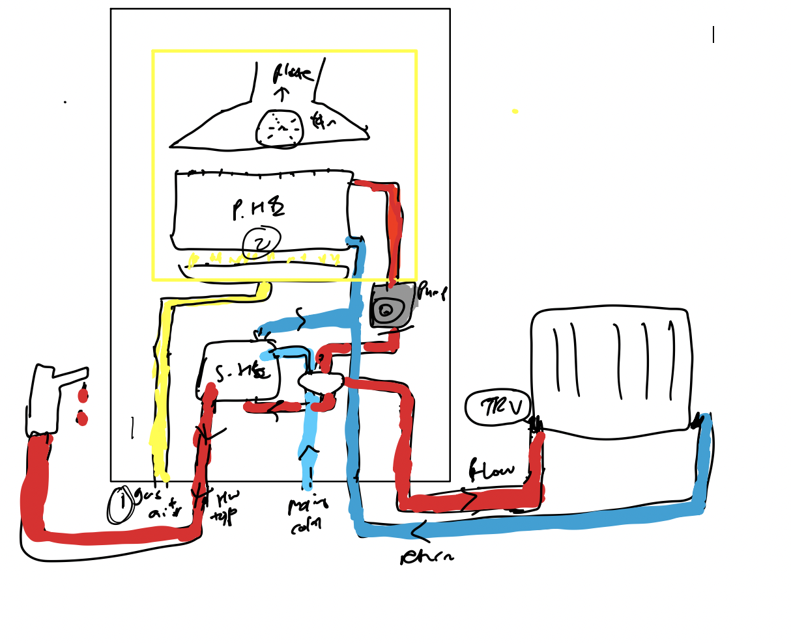 
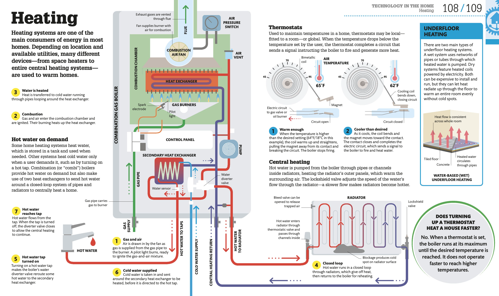

### Heat pump

Let's start from the fundamentals to understand how a heat pump works. Beginning with the **First law of thermodynamics** which states energy cannot be created or destroyed, it can only be transferred. It can also expressed as: 
ΔU = Qnet - W
Where:
- ΔU is the change in internal energy 
- Qnet is the net heat added to the system 
- W is the work done by the system

A basic diagram of the flow of energy for heat pumps:
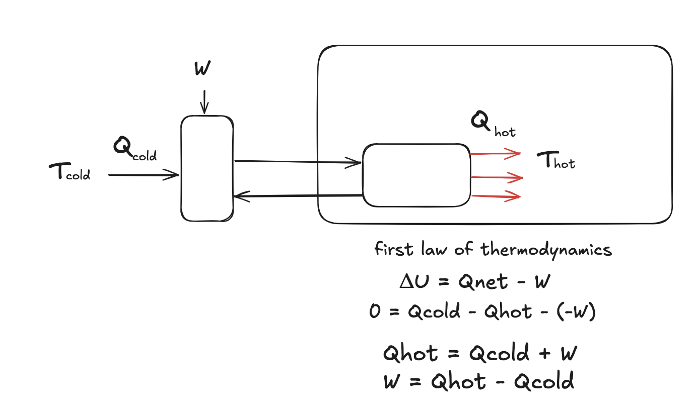    
The equation for the first law of thermodynamics can be modified for heat pumps:
- Work is done on the system by a compressor to transfer heat from a cold environment to a hot environment. Therefore, the work term becomes positive: -(-W).
- At the end of a cycle the heat pump returns to the same state as at the beginning, so the change in internal energy in one cycle is zero: ΔU = 0
- Qnet = Qcold - Qhot where Qcold is energy from cold environment and Qhot is the heat delivered to hot environment

To get the performance of a heat pump we care about Qhot relative to the W we put in. If we substitute the work equation we found earlier 
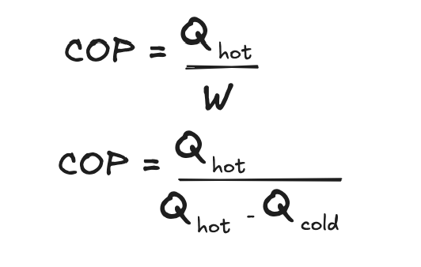    

Now we have the equation for the COP of heat pumps let's turn to the second law of thermodynamics. The second law of thermodynamics states **Heat will not spontaneously flow from a lower temperature to a higher temperature.** This means that heat flows from hot to cold unless some energy is inputted which is what a heat pump does.

The Carnot COP is the maximum COP that a heat pump can achieve in a given environment. We can understand this by looking at the reversed Carnot cycle which is applicable for heat pumps. The reversed carnot cycle consists of four reversible processes:
1. **Isothermal Expansion**
    - Gas absorbs heat from cold environment -> Entropy increases
    - Isothermal process is where the temperature remains constant 
2. **Adiabatic Compression**
    - Gas is compressed, heating up gas. No heat transfer -> Entropy remains constant.
    - Adiabatic is a process with no heat transfer
3. **Isothermal Compression**
    - Gas releases heat Qhot to the hot environment -> Entropy decreases
    - Work is done on the system during compression
4. **Adiabatic Expansion**: 
    - Gas expands, cooling to the cold environment temperature -> entropy remains constant. Temperature drops

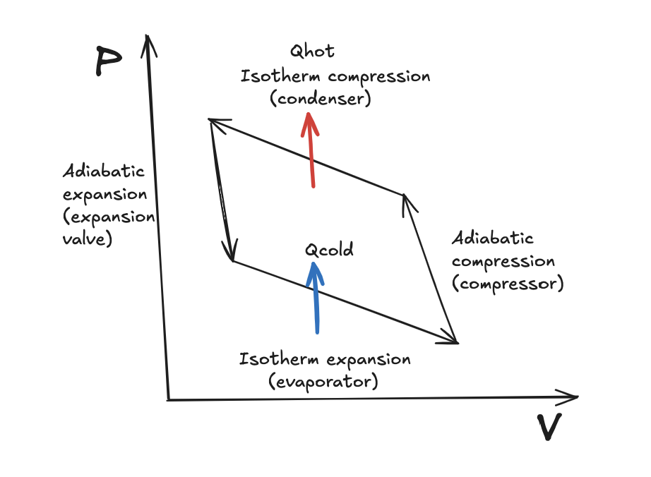    

For a reversible cycle, the net entropy change of the system and environment is zero. This is because the system returns to its initial state after one full cycle, so its net entropy change is zero. **Entropy gained by the environment** equals **entropy lost by the system**.

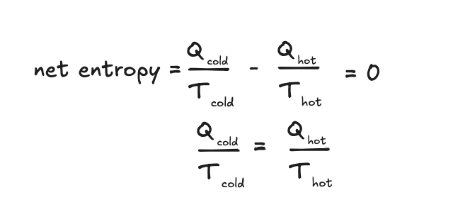    

We can then put this in the equation we derived earlier to get the Carnot COP.  This is the maximum theoretical efficiency a heat pump can achieve.
    

In reality, the Carnot COP is hardly achieved due to: 
- Friction losses in mechanical parts
- Heat loss from case
- Refrigerant losses
- Part load operation - cycling drops efficiency due to stop starts  
- Heat exchanger area - larger exchangers improve efficiency
- Defrost cycles needed
- Pumps and Fans require additional electrical input

This is why standardised lab tests are conducted to find out the real performance of heat pumps in a range of conditions. For example, in Europe the EN 14825 is done. The EN 14825 calculates COP at different outdoor temperatures ( -7°C, +2°C, +7°C, +12°C) and part-load ratios (88%, 54%, 35%, 15% of design heating demand) at temperature profiles for average, warmer, and colder climates.

We can also understand the heat pumps from the actual components:

 1. **Refrigerant**
- Heat pumps operate using a special fluid called the refrigerant. What’s unique about refrigerants is that it boils at very low temperatures. This characteristic allows the capture of energy even from low temperatures. The refrigerant begins as a low pressure, low temperature liquid, which is directed to the evaporator.

 2. **Evaporator**
- The evaporator, a heat exchanger, interacting with outside air for air source heat pumps, causes the refrigerant to boil as ambient air passes over it, transforming the refrigerant into a low temperature cold vapour. As the liquid boils it gains energy from the outside air, causing it to evaporate into a gas. This vapour is then carried to the compressor. They also have a fan to ensure airflow over the heat exchanger.

 3. **Compressor**
- Before the compressor works, a reversing valve or a 4 way valve is used to switch between heating and cooling. It allows the flow to reversed when needed e.g. defrost it reverses to melt ice on the evaporator. 
- The compressor uses electricity to increase the pressure of the refrigerant which causes the temperature to rise. The high pressure high temperature vapour is then taken to the condenser. 

 4. **Condenser**
- The condenser is a heat exchanger, which releases energy to the water in the storage tank. During this process, the refrigerant undergoes condensation, releasing energy and transforming into a liquid.
- The refrigerant then passes out the storage tank and to the expansion vessel.

 5. **Expansion vessel**
- The expansion vessel drops the pressure, leading to a drop in temperature. The now low pressure, low temperature liquid repeats the cycle by returning to the evaporator.

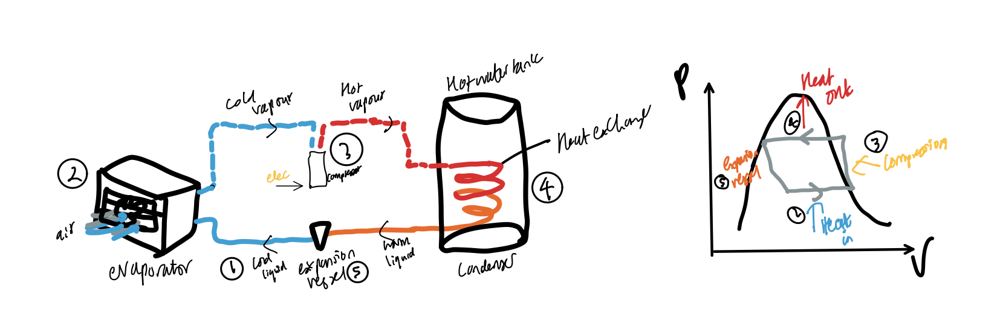    

### Heat network
- Supplied by boilers, or CHP plus boilers.
- Distribution losses and pumping energy.
- Recovered heat sources (waste combustion, power stations, high- and low-grade recovery,
geothermal).
- Heat sources and DHW-only heat networks.
- Solar heating within heat networks

### Heat battery
A heat battery (or thermal battery) stores energy as heat instead of electricity. It absorbs surplus energy, keeps it inside an insulated unit, and releases it later for space heating or hot water

You save money by charging during cheap times on cheap tariff.

Phase Change Materials (PCMs): Many residential units (such as those by Sunamp) use safe, salt-based materials like sodium acetate or paraffin wax. When charged with electricity or heat, the solid material melts and absorbs a massive amount of "latent heat". When you turn on your hot tap or heating, the liquid turns back into a solid and releases that stored heat into your home's plumbing.

### Heat interface unit 

## Emitters
### Wet distribution 
#### Radiator
#### Fan coil
#### underfloor

### Electric distribution
### Instant electric heater
### Electric storage heater

# Space cooling system
Air conditioning units - how do they work?
Domestic air-conditioning (AC or A/C) units are designed to draw in warm air from a living space and then cool it by evaporation, in a similar process to that used in refrigerators. A closed circuit of refrigerant, moved around by a pump, cools warm air drawn in by a fan. The refrigerant then transports the transferred heat out of the building to an external condenser, where the heat dissipates into the air outside. The refrigerant starts another cycle by flowing through an expansion valve, which lowers its pressure and temperature, ready to cool more air. As the air indoors cools, droplets of water vapor condense into liquid, leaving the air less humid as well as cooler.
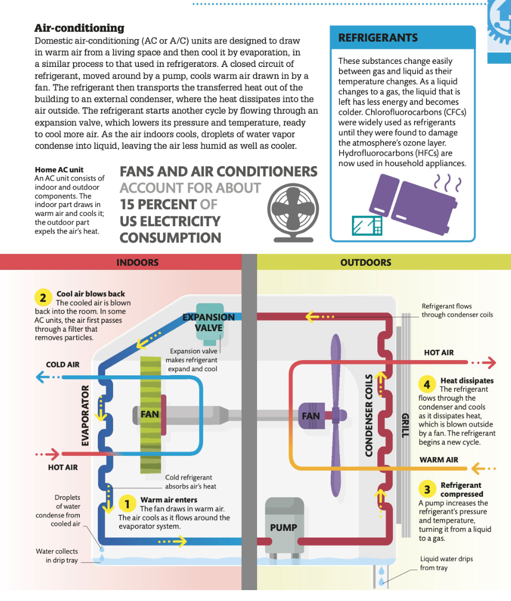

# Water heating demand
Vd = (25 * N) + 36

If Water heating by a boiler for which EN 13203-2 or OPS 26 data are not available
nwater = []
for i in range(len(output_water_heater)):
    nwater_mon = (space_heat_final[i] + output_water_heater[i] )/ ((space_heat_final[i]/nwinter) +(output_water_heater[i]/nsummer))
    nwater.append(nwater_mon)
eff_water_heater = nwater

fuel_water_heating = [output*100/(eff) for eff, output in zip(eff_water_heater,output_water_heater)]

elec
mech_vent = False
elec_mech_fans = 0
if mech_vent:
    IUF = 1.1
    SFP = 0.9
    elec_mech_fans = IUF * SFP * 1.22 * DV
elec_flue_fan = 45
elec_heating_circ = 30
elec_warm_air_fans = 0 
elec_oil_boiler_aux = 0
elec_keep_hot_gas_combi = 0
elec_pump_solar_water = 0
elec_storage_wwhr = 0
Calculations
total_electricity_pumps = elec_mech_fans + elec_warm_air_fans + elec_heating_circ + elec_oil_boiler_aux +elec_keep_hot_gas_combi+elec_pump_solar_water + elec_storage_wwhr +elec_flue_fan

### Mixer shower
### Electric shower
### Bath
### Other

# Renewable

### Solar PV
1. Solar energy: sunlight comprises tiny energy packets called photons. When photons hit a solar panel, made of dozens of PV cells, they transfer energy to electrons that then flow via conductors through an external circuit as an electrical current.
2. Converting current (DC->DC): An inverter converts electricity from the panel DC into AC, which is then usable by the home.
3. Distributing power: the electricity is sent from the main panel around the home. The panel can accept electricity from the local grid when the solar panels do not meet demand.
4. Measuring power: a smart meter keeps track of energy generation and electricity use in both directions.
5. Connecting to the grid: Any excess electricity produced by the solar panels is sent to the power grid and credited to householder.

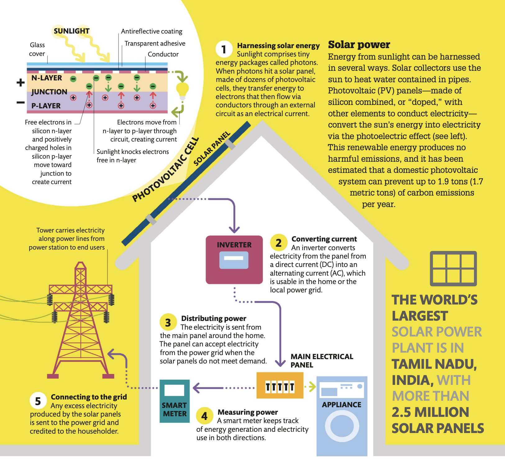

### Electric Batteries
Electric Batteries are a portable store of chemical energy that can converted into electrical energy. Primary (single use) and secondary(rechargeable). 

1. chemical reactions: when a battery is connected to an electric circuit, a chemical reaction makes the metal atoms lose electrons. These are attracted to and gained by a chemical paste called electrolyte.
2. electrons gather: free electrons are drawn towards an anode, creating an imbalance with a deficit of electrons at the anode and an excess at the anode. The electrons freed by the chemical reaction move towards the anode inside the battery but cannot get any further until an eternal circuit is connected.
3. migrating electrons: the external circuit connecting the anode and cathode provide a path along which the electrons can flow, producing an electric current. Along the way, this current can be used to power an electrical device.
4. incoming electrons: the electrons re-enter the battery via the cathode. The flow continues until the store of chemicals is exhausted.

Recharging:
when a battery is plugged into a charger, a current is passed through in the opposite direction that was discharging. This moves electrons back to where they started, recharging the battery.

Lithium ion batteries
- large number of electrons in reactive metal lithium
- lithium has a low weight but high energy density -> good power to weight ratio for batteries  that can withstand hundreds of discharge and recharge cycles. 

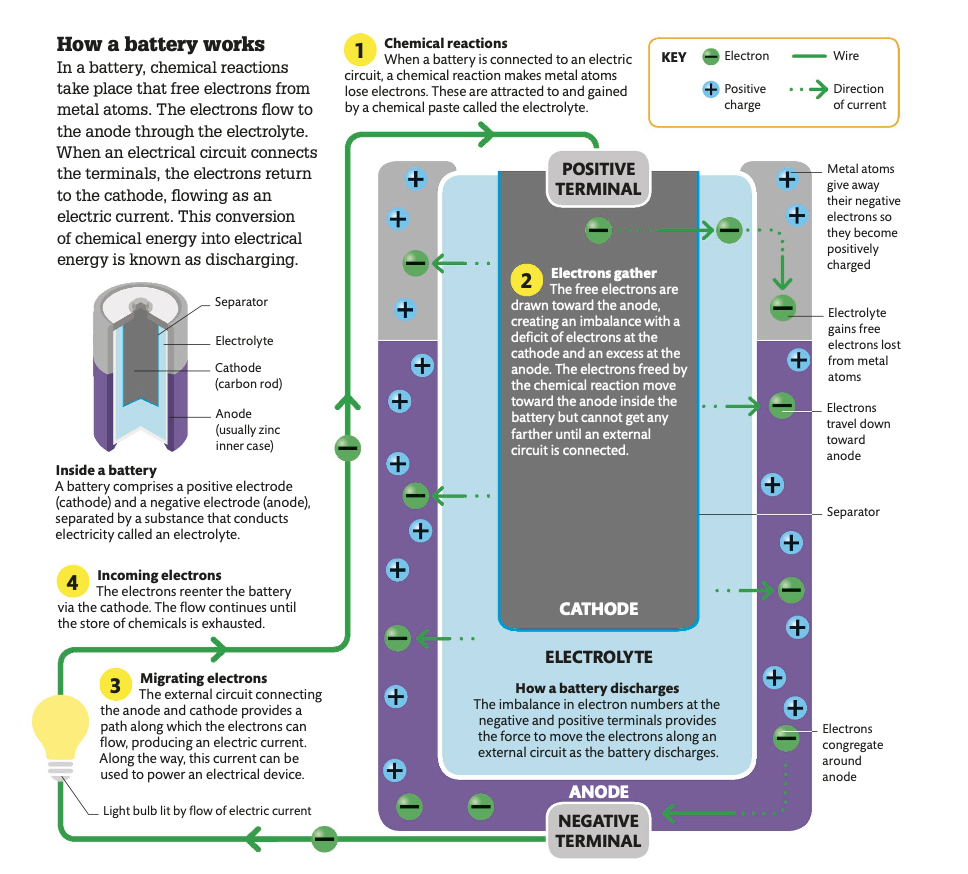

When batteries and PV are used [together](https://www.researchgate.net/publication/335936048_Reliability_Evaluation_of_PV_Systems_with_Integrated_Battery_Energy_Storage_Systems_DC-Coupled_and_AC-Coupled_Configurations?_tp=eyJjb250ZXh0Ijp7ImZpcnN0UGFnZSI6Il9kaXJlY3QiLCJwYWdlIjoiX2RpcmVjdCJ9fQ): 
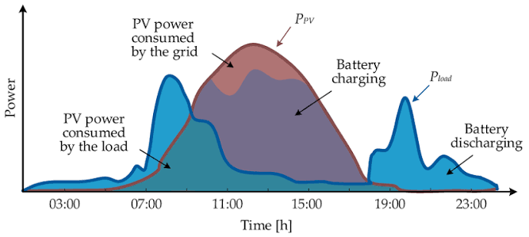

Solar PV and batteries save money together by storing free PV during the day so you can avoid buying grid electricity during expensive peak hours. Instead of exporting your extra solar power away for a small payout, the battery saves it to run your home when electricity costs the most.

total_delivered_energy = space_heating_fuel_main1_annual + space_heating_fuel_main2_annual + fuel_water_heating_annual + total_electricity_pumps + lighting

# Inputs
# p/kWh
fuel_price_gas = 3.48
fuel_price_elec = 13.19
energy_cost_deflator = 0.42
standing_charges = 120

# Calculations
space_heating_cost_main1 = space_heating_fuel_main1_annual   * fuel_price_gas * 0.01
space_heating_cost_main2 = space_heating_fuel_main2_annual  * fuel_price_elec * 0.01
water_heating_cost = fuel_water_heating_annual  * fuel_price_gas * 0.01
total_electricity_pumps_cost =  total_electricity_pumps  * fuel_price_elec * 0.01
lighting_cost = lighting  * fuel_price_elec * 0.01
total_energy_cost = standing_charges + space_heating_cost_main1 + space_heating_cost_main2 +water_heating_cost+total_electricity_pumps_cost + lighting_cost

space_heating_co2_main1_annual = space_heating_fuel_main1_annual * emission_factor_gas
space_heating_co2_main2_annual = space_heating_fuel_main2_annual * emission_factor_elec
water_heating_co2 = fuel_water_heating_annual * emission_factor_gas 
total_electricity_pumps_co2 =  total_electricity_pumps  * emission_factor_elec 
lighting_co2 = lighting * emission_factor_elec
total_co2 = space_heating_co2_main1_annual + space_heating_co2_main2_annual + water_heating_co2 +total_electricity_pumps_co2 + lighting_co2

